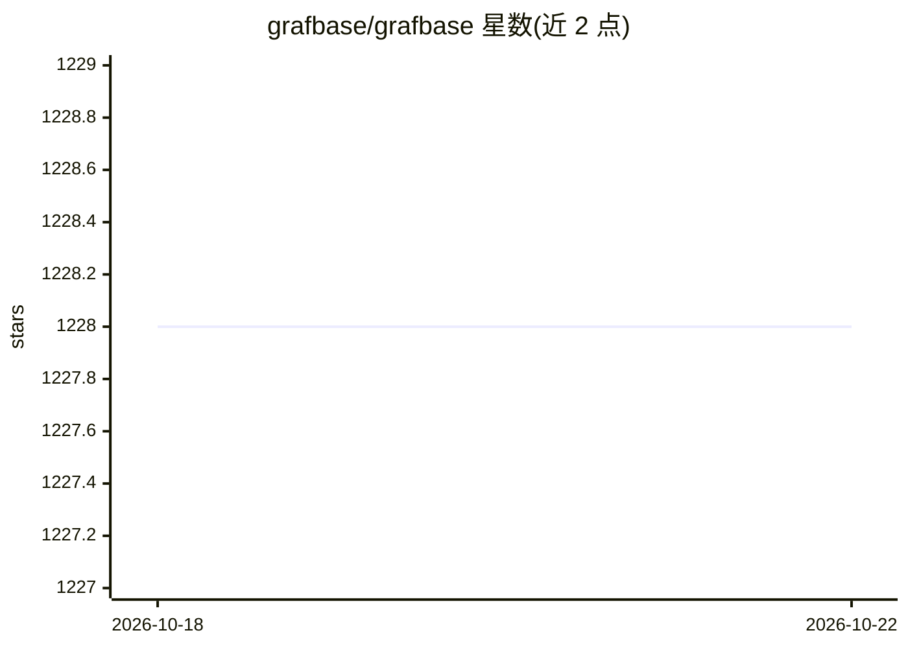

# grafbase/grafbase

⭐ 1,228 · Rust · MPL-2.0 · 推送 2026-07-01 · [GitHub](https://github.com/grafbase/grafbase) · [官网](https://the-guild.dev/graphql/hive/blog/acquired-grafbase) · 组织维护

**GraphQL Federation 网关，已被收购并进入维护模式**

Grafbase 是用 Rust 实现的 GraphQL Federation Gateway，主题标签含 MCP（Model Context Protocol）支持。README 当前内容为公告：The Guild 已收购 Grafbase；Grafbase 平台、dashboard 与 app 已停止运营；Grafbase Gateway 与 CLI 处于维护模式，仅做高严重性安全修复，仓库将于 2026 年 5 月底归档。README 引导用户转向 Hive Router/Hive Gateway 或 Hive Console。原 README 仅以链接形式保留。

## 筛选速览

| 维度 | 判定 | 备注 |
|---|---|---|
| AI 角色 | `ai-ecosystem` | LLM/agent 周边工具 |
| 许可风险 | `permissive` | MPL-2.0 |
| 部署形态 | `None` |  |
| 模型依赖 | — | README 未给出锁定关系 |
| 硬件要求 | — | 无带数字的原话,不猜 |
| 安装摩擦 | `low` | 无编译、无系统依赖或容器化 |
| 成熟度 | — | 结构信号不足 |

## 能力要点

- Rust 实现的 GraphQL Federation 兼容网关
- 主题标签包含 MCP（Model Context Protocol）
- 仓库处于维护模式，计划 2026 年 5 月底归档

## 适用场景

- 已部署用户查看项目现状与迁移指引
- 选型前确认该网关的维护与归档时间线

## 场景标签

 · 领域:API 基础设施/GraphQL

## 证据(README 行号)

> L9: > Grafbase Gateway, Grafbase CLI and other components in this repository are currently on maintenanace mode. During 
> L12: > If you are looking for a performant and Federation-compatible GraphQL router, please refer to Hive Router or Hive

## 星数曲线

2026-10-18 1,228 → 2026-10-22 1,228（+0）

---
*卡片 v1 · prompt 1.4 · 生成 2026-10-21 · 置信度 low · 依据 README sha `16c184ff4885` · [字段定义](../../DATASET.md)*
