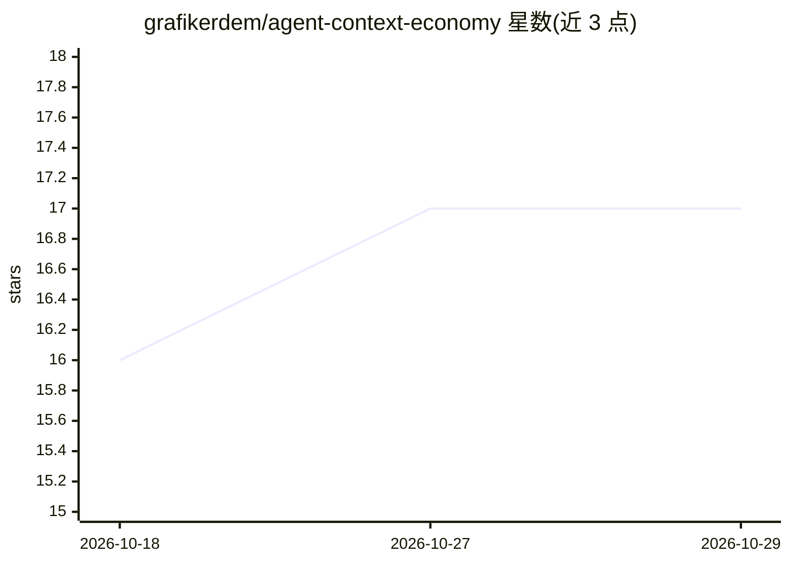

# grafikerdem/agent-context-economy

⭐ 17 · PowerShell · MIT · 推送 2026-07-07 · [GitHub](https://github.com/grafikerdem/agent-context-economy) · 个人维护

**面向自主编码 agent 的渐进式源码导航框架，节省模型上下文**

ACE 是一套以 PowerShell 脚本为主的渐进式源码导航工具集，供 Codex、Cursor、Windsurf、Claude Code、Gemini 等编码 agent 使用。它通过六层工作流（Continuity→Repository Map→Discovery→Targeted Reading→Workflow→Validation）按 Summary/Signature/Body/Full 分层读取代码，配合抽象 token 预算、智能截断与 provenance footer，减少终端输出与全量源码读取造成的 token 消耗。脚本只读仓库（除 .agent-state 与 benchmark 输出），无外部依赖；README 附可本地复现的合成基准，并声明结果因仓库与 agent 行为而异。

## 筛选速览

| 维度 | 判定 | 备注 |
|---|---|---|
| AI 角色 | `ai-ecosystem` | LLM/agent 周边工具 |
| 许可风险 | `permissive` | MIT |
| 部署形态 | `None` |  |
| 模型依赖 | — | README 未给出锁定关系 |
| 硬件要求 | — | 无带数字的原话,不猜 |
| 安装摩擦 | `low` | 无编译、无系统依赖或容器化 |
| 成熟度 | — | 结构信号不足 |

## 能力要点

- Summary/Signature/Body/Full 四层渐进式代码读取
- 抽象 token 预算与智能截断（保留定义、起止、省略中段）
- 12 个 PowerShell 辅助脚本（repo-map、investigate、read-symbol 等）
- 本地可复现的 benchmark 脚本衡量行数/token 削减

## 适用场景

- 让编码 agent 按需分层读取源码，减少上下文消耗
- 生成仓库地图与紧凑简报供 agent 快速定位
- 压缩测试、构建、diff 等诊断输出的体积

## 场景标签

 · 领域:开发者工具/AI agent 基础设施

## 证据(README 行号)

> L11: **ACE (Agent Context Economy) is a cross-platform, LLM-first progressive source navigation framework that helps aut
> L16: ACE works with coding agents such as Codex, Cursor, Windsurf, Claude Code, and Gemini. The methodology is tool-agno

## 星数曲线

2026-10-18 16 → 2026-10-29 17（+1）

---
*卡片 v1 · prompt 1.4 · 生成 2026-10-29 · 置信度 high · 依据 README sha `a7ecaa5697cc` · [字段定义](../../DATASET.md)*
