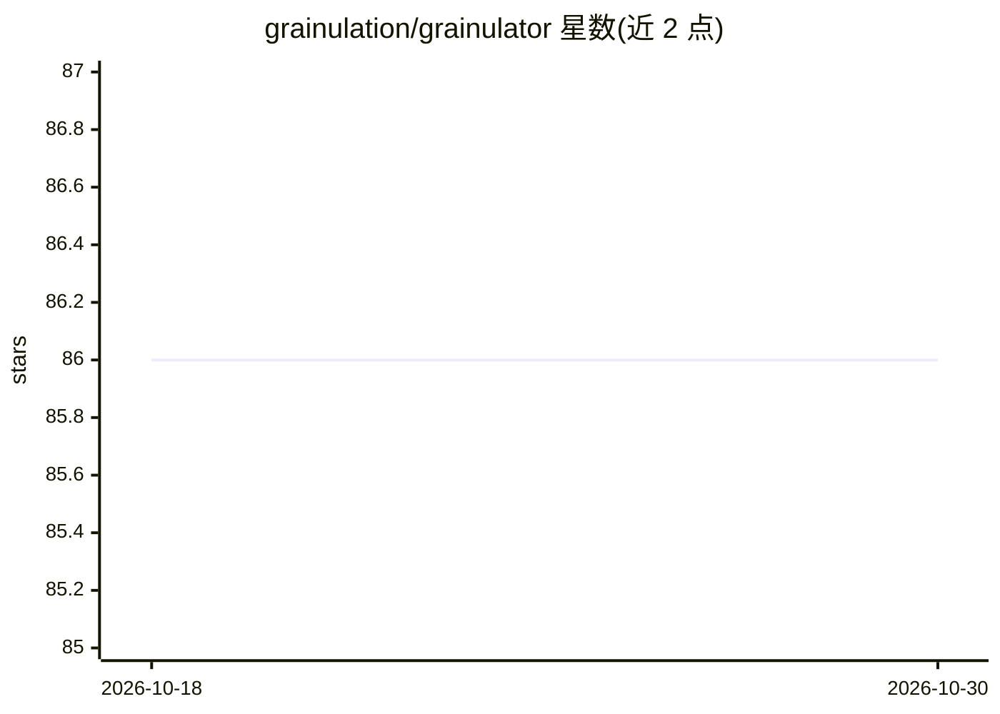

# grainulation/grainulator

⭐ 86 · JavaScript · MIT · 推送 2026-10-27 · [GitHub](https://github.com/grainulation/grainulator) · [官网](https://grainulator.app/) · 组织维护

**给 AI agent 的证据台账与验证工作流工具（CLI + MCP）**

面向 Claude Code、Codex 等 coding/agent 环境的证据管理工具：以本地 ledger 记录带类型、来源与证据层级的 claim，提供冲突检测、弱支撑信号与待调查缺口，并把后续动作分为 Auto/Manual 两类清单；支持会话停止/恢复与无凭证导出，可接入用户提供的 verifier 形成命令循环。以 CLI 和 MCP server 两种形式交付，通过插件接入 Claude Code/Codex，其他 agent 经 MCP 连接。需 Node.js 24+，v2.0.4 为 GitHub release 而非 npm 发布。文档明言：编译器只核验台账结构与支撑记录，不判定来源真伪，评测亦未确立一般性准确率或效率增益。

## 筛选速览

| 维度 | 判定 | 备注 |
|---|---|---|
| AI 角色 | `ai-ecosystem` | LLM/agent 周边工具 |
| 许可风险 | `permissive` | MIT |
| 部署形态 | `None` |  |
| 模型依赖 | — | README 未给出锁定关系 |
| 硬件要求 | — | 无带数字的原话,不猜 |
| 安装摩擦 | `low` | 无编译、无系统依赖或容器化 |
| 成熟度 | — | 结构信号不足 |

## 能力要点

- 本地 ledger：带类型/来源/证据层级的 claim，跨模型与会话保留
- 冲突检测、弱支撑信号与 Auto/Manual 后续动作清单
- CLI 与 MCP server 双形态，插件接入 Claude Code/Codex
- 可附加自定义 verifier 的受管命令循环

## 适用场景

- 让 agent 在调研中记录证据、核查假设并输出可继续/需人工的待办
- 跨模型、跨会话携带研究上下文与证据台账
- 对 agent 产出的结论做冲突与弱支撑检查

## 场景标签

`Agent 记忆` · 领域:Agent 开发

## 证据(README 行号)

> L27: Good models still need a way to keep track of evidence, revisit assumptions, and verify their work. Grainulator giv
> L37: Grainulator works with Claude Code and Codex through plugins. It also provides a command-line tool and an MCP conne

## 星数曲线

2026-10-18 86 → 2026-10-30 86（+0）

---
*卡片 v1 · prompt 1.4 · 生成 2026-10-24 · 置信度 high · 依据 README sha `fc5170d05a4e` · [字段定义](../../DATASET.md)*
