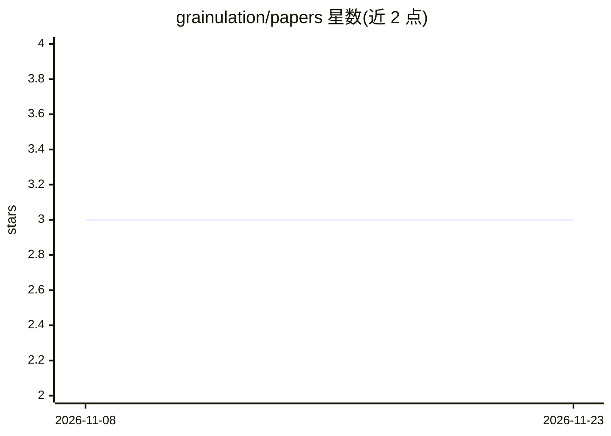

# grainulation/papers

⭐ 3 · Python · Apache-2.0 · 推送 2026-11-18 · [GitHub](https://github.com/grainulation/papers) · [官网](https://blog.grainulation.org/verify-then-vote/) · 个人维护

**多智能体系统证据与验证研究的论文集**

围绕多智能体 LLM 系统中证据与验证主题的论文集合仓库，收录论文《Overturning Wrong Majorities in Multi-Agent LLMs》及其补充材料、形式化证明、代码与复现数据。每篇论文附带协议、记录输入、检查器标签等可检视材料，并提供 artifact 指引与固定工具链用于复现分析和证明检查。文档可用 Tectonic 或 latexmk/pdfLaTeX 构建。目前处于首次公开发布的准备阶段，代码采用 Apache 2.0，论文与图表采用 CC BY 4.0。

## 筛选速览

| 维度 | 判定 | 备注 |
|---|---|---|
| AI 角色 | `ai-knowledge` | 知识聚合/清单类 |
| 许可风险 | `permissive` | Apache-2.0 |
| 部署形态 | `None` |  |
| 模型依赖 | — | README 未给出锁定关系 |
| 硬件要求 | — | 无带数字的原话,不猜 |
| 安装摩擦 | `low` | 无编译、无系统依赖或容器化 |
| 成熟度 | `idea` | |

## 能力要点

- 论文、补充材料、形式化证明、代码与记录数据一并发布
- catalogue.yaml 提供机器可读的论文索引
- 提供复现结果所需的命令与固定工具链
- 支持 arxiv 目标生成含独立文档的源码包

## 适用场景

- 阅读多智能体 LLM 投票与证据验证的研究结果
- 按 artifact 指引复现论文中的分析与证明检查
- 通过 issue 提交更正或复现报告

## 场景标签

 · 领域:学术研究/论文集

## 证据(README 行号)

> L7:  Research on evidence and verification in multi-agent systems.
> L8:  Manuscripts, formal proofs, code, and the recorded data behind the results.
> L25: **Overturning Wrong Majorities in Multi-Agent LLMs** · November 2026

## 星数曲线

2026-11-08 3 → 2026-11-23 3（+0）

---
*卡片 v1 · prompt 1.4 · 生成 2026-11-22 · 置信度 high · 依据 README sha `f8b4a05f2851` · [字段定义](../../DATASET.md)*
