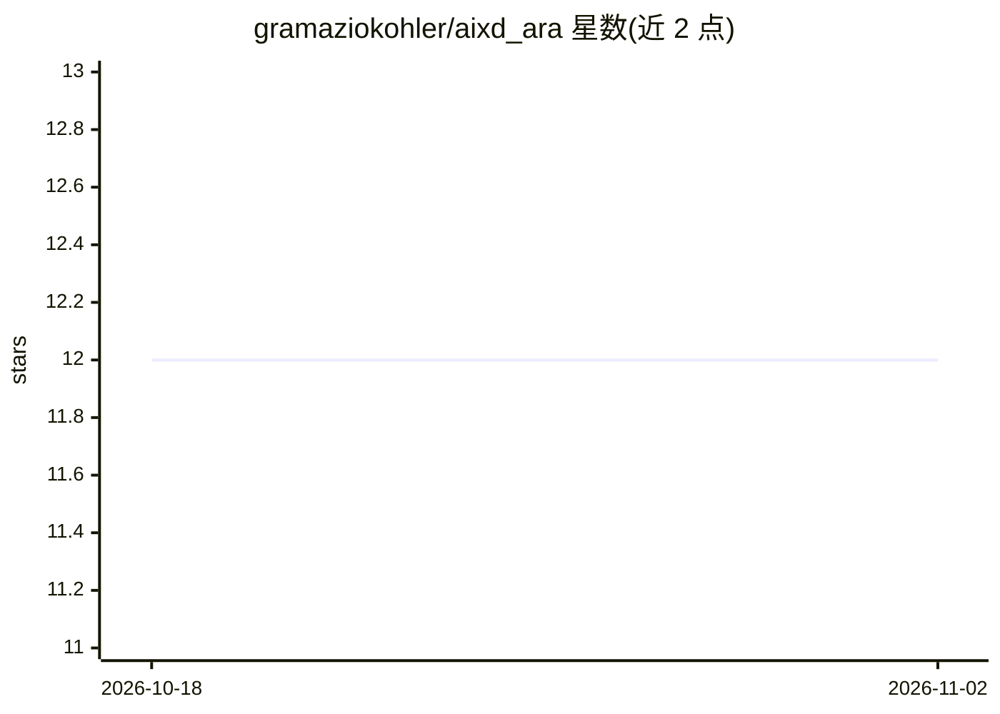

# gramaziokohler/aixd_ara

⭐ 12 · Python · MIT · 推送 2025-11-17 · [GitHub](https://github.com/gramaziokohler/aixd_ara) · [官网](https://gramaziokohler.github.io/aixd_ara/) · 组织维护

**面向建筑师的 Grasshopper 插件：用生成式 AI 做逆向设计**

ARA 是 Rhino/Grasshopper 参数化建模环境下的插件，基于 AIXD 工具箱：从既有参数化模型定义生成项目专属数据集，训练并部署自定义自编码器（autoencoder）模型，生成满足目标值（如性能指标、设计约束）的设计变体，即逆向设计范式。附带数据分析与性能评估的可视化工具。使用者通过 pip/conda 安装 Python 包后，再以 compas_rhino 命令安装 Grasshopper 插件组件；运行依赖 axid==0.13.0、compas>2.0、flask。

## 筛选速览

| 维度 | 判定 | 备注 |
|---|---|---|
| AI 角色 | `ai-native` | 本体是模型或模型工具 |
| 许可风险 | `permissive` | MIT |
| 部署形态 | `library` | 以包/库形式分发 |
| 模型依赖 | — | README 未给出锁定关系 |
| 硬件要求 | — | 无带数字的原话,不猜 |
| 安装摩擦 | `low` | 无编译、无系统依赖或容器化 |
| 成熟度 | — | 结构信号不足 |

## 能力要点

- 从 Grasshopper 参数化模型生成项目专属数据集
- 训练并部署自定义 autoencoder 生成设计变体
- 按目标值（性能指标/设计约束）匹配的逆向设计流程
- 提供数据分析与性能评估可视化工具

## 适用场景

- 在 Grasshopper 中快速生成符合项目目标的设计变体
- 为自己的参数化模型构建数据集并训练生成模型
- 设计探索阶段用生成式模型加速方案枚举

## 场景标签

`数据分析` `模型训练` · 领域:效率与自动化

## 证据(README 行号)

> L10: **Grasshopper plugin for data-driven and inverse design methods with generative AI.**
> L14: With **ARA**, you can easily generate a project-specific the dataset from an existing parametric model definition i

## 星数曲线

2026-10-18 12 → 2026-11-02 12（+0）

---
*卡片 v1 · prompt 1.4 · 生成 2026-11-01 · 置信度 high · 依据 README sha `260b9c4865c4` · [字段定义](../../DATASET.md)*
