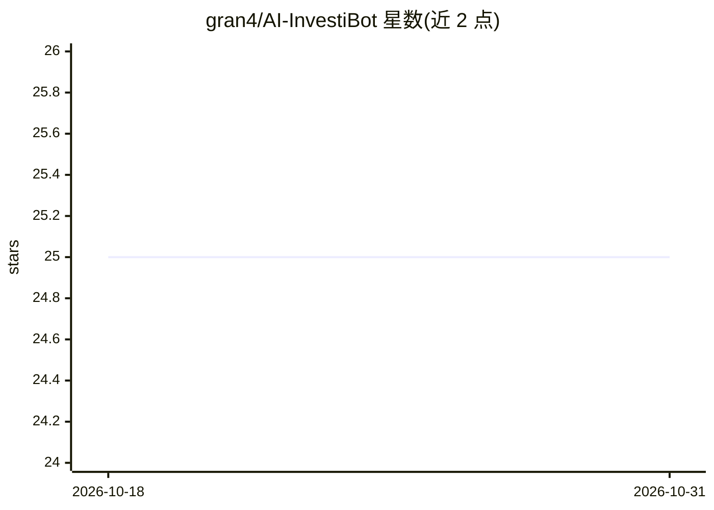

# gran4/AI-InvestiBot

⭐ 25 · Python · MIT · 推送 2026-01-02 · [GitHub](https://github.com/gran4/AI-InvestiBot) · 个人维护

**股票 LSTM 模型实验工具箱：训练、验证与决策自动化**

面向股票的量化研究脚本集合：从 Yahoo Finance（AlphaVantage/Stooq 兜底）抓取历史行情并缓存为指标 JSON，提供 PriceModel/PercentageModel/DirectionalModel 三类 LSTM 模型与可插拔的 Keras 模型构建回调，内置 walk-forward 验证、批量实验对比 CLI（holdout_monitor），以及将多个已训练策略的预测送入 DecisionTreeClassifier 投票的 decision_maker。含 Lambda-ready 的 serverless 骨架。README 明确声明实盘交易仍属实验性，建议仅用于研究/回测。

## 筛选速览

| 维度 | 判定 | 备注 |
|---|---|---|
| AI 角色 | `ai-native` | 本体是模型或模型工具 |
| 许可风险 | `permissive` | MIT |
| 部署形态 | `library` | 以包/库形式分发 |
| 模型依赖 | — | README 未给出锁定关系 |
| 硬件要求 | — | 无带数字的原话,不猜 |
| 安装摩擦 | `low` | 无编译、无系统依赖或容器化 |
| 成熟度 | `idea` | |

## 能力要点

- 三类 LSTM 模型（价格/百分比/方向）支持 create_model 回调插拔架构
- walk-forward 验证封装于 train(test=True) 与 holdout_monitor CLI
- 指标中心缓存 info.json（ earnings 差分、kumo、supertrend 等自定义指标）
- decision_maker 将多策略预测聚合进 DecisionTreeClassifier 交易投票

## 适用场景

- 批量对比不同指标组合与模型结构的回测表现
- 研究 indicator-heavy LSTM 在股票价格/方向预测上的表现
- 将多个已训练策略组合为聚合交易决策信号

## 场景标签

`金融量化` · 领域:学习与行业

## 证据(README 行号)

> L3: AI-InvestiBot provides scripts and utilities for experimenting with indicator-heavy LSTM models, walk-forward valida
> L66: - **PriceModel**: Predicts price directly after scaling against historical min/max.
> L68: - **DirectionalModel**: Optimized for sign accuracy, with curriculum stages, balanced focal loss, and automatic thr

## 星数曲线

2026-10-18 25 → 2026-10-31 25（+0）

---
*卡片 v1 · prompt 1.4 · 生成 2026-10-27 · 置信度 mid · 依据 README sha `363990612b74` · [字段定义](../../DATASET.md)*
