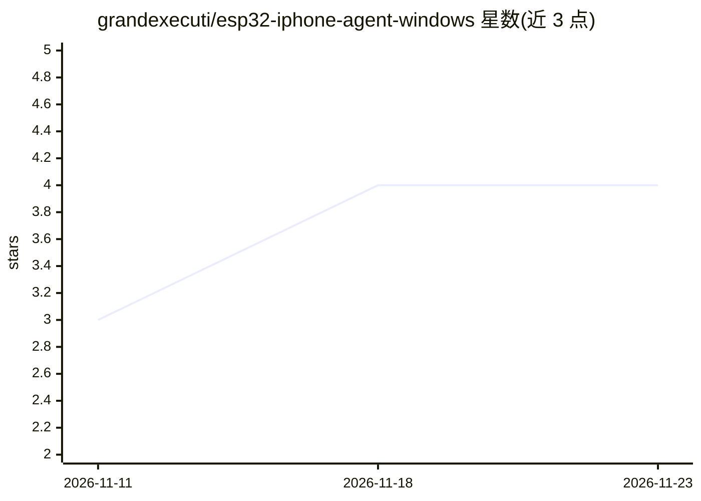

# grandexecuti/esp32-iphone-agent-windows

⭐ 4 · Python · MIT · 推送 2026-10-23 · [GitHub](https://github.com/grandexecuti/esp32-iphone-agent-windows) · 个人维护 · 中文 README

**让 Windows PC 通过 ESP32+AirPlay 控制真实 iPhone 并供 AI 操作**

基于 onehumanbeing/esp32-iphone-agent 的 Windows 移植改造：ESP32-S3 板子模拟 USB 鼠标键盘充当"手"，AirPlay/UxPlay 投屏充当"眼"，服务端以 FastAPI 提供网页实时画面、HTTP 控制接口（点按/滑动/输入/手势）与 `/api/agent` 视觉模型自动化接口。本仓库新增命名管道取帧、绕开 GPU 渲染的视频管线、指针闭环瞄准修正、中文输入通道、ZCode 技能与诊断工具集。需自备 ESP32-S3 硬件并刷固件，Windows 10/11 + Python 3.10+ 运行。

## 筛选速览

| 维度 | 判定 | 备注 |
|---|---|---|
| AI 角色 | `ai-enhanced` | 去掉 AI 部分产品仍成立 |
| 许可风险 | `permissive` | MIT |
| 部署形态 | `desktop` | 安装包/桌面程序 |
| 模型依赖 | — | README 未给出锁定关系 |
| 硬件要求 | `cpu-ok` | |
| 安装摩擦 | `low` | 无编译、无系统依赖或容器化 |
| 成熟度 | `idea` | |

## 能力要点

- Windows 命名管道取帧后端，绕开 D3D/GPU 渲染环节
- 指针闭环瞄准（最多 3 轮测量修正）与漂移消除
- 不改固件利用 iOS 输入法实现中文拼音输入流程
- 截图→读图→操作→再截图验证的 ZCode 技能

## 适用场景

- 在 Windows 上实时查看并远程操控 iPhone 屏幕
- 让视觉模型在对话中代为操作 iPhone 应用并截图验证
- iOS 应用的手工/半自动测试

## 场景标签

`GUI 自动化` · 领域:效率与自动化

## 证据(README 行号)

> L19: - **自动化**：`/api/agent` 接口让视觉模型自己规划并执行任务（需在 `.env` 配模型）；
> L20: - **给 AI 工具用**：附带 ZCode 技能，直接在对话里说"看一下我手机 / 帮我点 XX"。
> L22: 整套东西跑在一台 Windows 10/11 电脑上（Python 3.10+），不需要 Mac、不需要 Linux。

## 星数曲线

2026-11-11 3 → 2026-11-23 4（+1）

---
*卡片 v1 · prompt 1.4 · 生成 2026-11-21 · 置信度 high · 依据 README sha `7ccbc7413e6e` · [字段定义](../../DATASET.md)*
