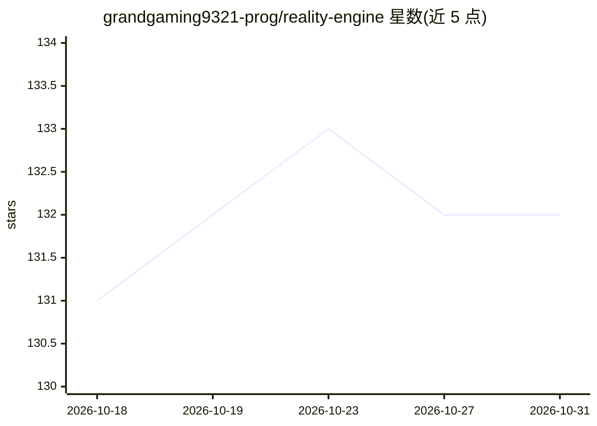

# grandgaming9321-prog/reality-engine

⭐ 132 · HTML · 推送 2026-10-30 · [GitHub](https://github.com/grandgaming9321-prog/reality-engine) · 个人维护

**AI 驱动的时间线模拟平台：推演架空历史与情景分支**

自述的时序沙盒模拟引擎：以 Temporal Graph Network 为核心，将事件与因果后果建模为图结构，支持在历史节点分叉时间线、生成概率性未来情景与叙事文本；包含自主 agent 社会建模、40+ 语言输出、Web 时间线界面、checkpoint 分支与 7x24 持续模拟。内核称以 Rust 编写，前端为 WebAssembly，MIT 许可。README 未给出可验证的安装命令或代码路径，仅描述从 release 下载。声明输出不预测真实事件，不作为高风险决策依据。

## 筛选速览

| 维度 | 判定 | 备注 |
|---|---|---|
| AI 角色 | `ai-native` | 本体是模型或模型工具 |
| 许可风险 | `none` | — |
| 部署形态 | `None` |  |
| 模型依赖 | — | README 未给出锁定关系 |
| 硬件要求 | — | 无带数字的原话,不猜 |
| 安装摩擦 | `low` | 无编译、无系统依赖或容器化 |
| 成熟度 | — | 结构信号不足 |

## 能力要点

- 时间线分叉、因果级联与回溯分析（Retrocausal Analysis）
- 带驱动力/记忆的自主 agent 社会建模与涌现结构
- 种子随机数下的模拟可复现性
- 支持导出纯文本日志、GraphML 与 JSON 事件流

## 适用场景

- 在历史转折点分叉时间线观察长期后果
- 为 RPG 与策略游戏生成背景编年史与派系历史
- 对市场、气候、政策变量做假设情景推演

## 场景标签

 · 领域:模拟/叙事生成

## 证据(README 行号)

> L5: **An AI-Driven Temporal Sandbox for Simulating Alternate Histories, Future Scenarios, and Cause-Effect Cascades Acro
> L17: - **Generative Narrative Design**: For writers and game masters, Chronos Engine acts as an **automated plot weaver*
> L86: Chronos Engine is written in Rust for the core simulation kernel, ensuring memory safety and high throughput even d

## 星数曲线

2026-10-18 131 → 2026-10-31 132（+1）

---
*卡片 v1 · prompt 1.4 · 生成 2026-10-22 · 置信度 low · 依据 README sha `7c8c58a64b76` · [字段定义](../../DATASET.md)*
