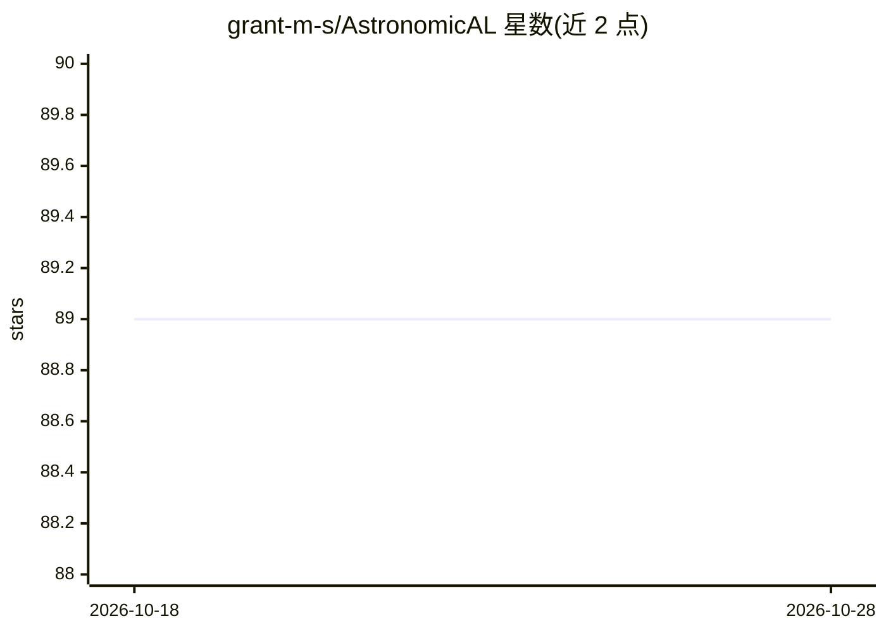

# grant-m-s/AstronomicAL

⭐ 89 · Python · GPL-3.0 · 推送 2026-10-07 · [GitHub](https://github.com/grant-m-s/AstronomicAL) · [官网](https://astronomical.readthedocs.io) · 个人维护

**本地人机协同科研数据工作台：探索、标注、建模一体化**

基于插件的本地交互式科学数据平台：核心提供数据集、选择状态、后台任务、派生产物与工作区持久化等基础设施，插件贡献面板、导入器与领域工具。功能包括交互式数据探索、领域检查（光谱/测光/图像/SED）、标注与审查、模型训练评估、基于预测与不确定性的主动学习、Hugging Face 等数据集导入。最初面向天文大数据主动学习，现已泛化到其他数据密集领域。通过 git clone 源码 + pip 依赖安装，用 panel serve 启动，README 声明处于活跃开发中。

## 筛选速览

| 维度 | 判定 | 备注 |
|---|---|---|
| AI 角色 | `ai-ecosystem` | LLM/agent 周边工具 |
| 许可风险 | `viral` | GPL-3.0 |
| 部署形态 | `library` | 以包/库形式分发 |
| 模型依赖 | — | README 未给出锁定关系 |
| 硬件要求 | — | 无带数字的原话,不猜 |
| 安装摩擦 | `low` | 无编译、无系统依赖或容器化 |
| 成熟度 | `idea` | |

## 能力要点

- 插件化架构：小核心 + 可安装插件（含插件市场与管理器）
- 主动学习：用模型预测和不确定性聚焦专家标注
- 天文领域检查：光谱、测光、SED、图像与外部巡天数据
- 工作区持久化与插件间派生产物共享

## 适用场景

- 天文大目录的人工检查与主动学习标注
- 导入图像数据集检查样本并训练分类器
- 科研团队按领域组合插件搭建自定义分析工作区

## 场景标签

`科研工具` `数据分析` · 领域:效率与自动化

## 证据(README 行号)

> L51: * **Machine learning** — configure, train, evaluate, and apply models from within the workspace, with long-running 
> L52: * **Active learning** — use model predictions and uncertainty to focus expert attention on informative examples ins
> L65: The platform provides the common infrastructure required by interactive workflows: datasets, selections, background

## 星数曲线

2026-10-18 89 → 2026-10-28 89（+0）

---
*卡片 v1 · prompt 1.4 · 生成 2026-10-23 · 置信度 mid · 依据 README sha `e29b6d0beb29` · [字段定义](../../DATASET.md)*
