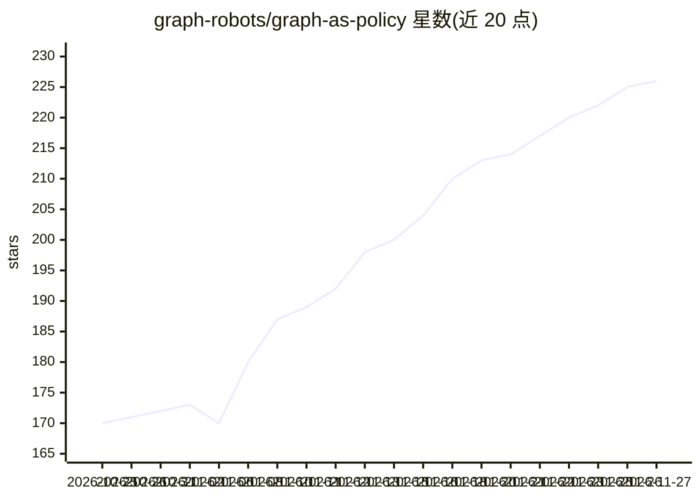

# graph-robots/graph-as-policy

⭐ 226 · Python · Apache-2.0 · 推送 2026-11-23 · [GitHub](https://github.com/graph-robots/graph-as-policy) · 组织维护

**把自然语言任务编译为可验证机器人技能图并执行的框架**

## 筛选速览

| 维度 | 判定 | 备注 |
|---|---|---|
| AI 角色 | `ai-ecosystem` | LLM/agent 周边工具 |
| 许可风险 | `permissive` | Apache-2.0 |
| 部署形态 | `None` |  |
| 模型依赖 | locked-api |  |
| 硬件要求 | `gpu-24g` | |
| 安装摩擦 | `low` | 无编译、无系统依赖或容器化 |
| 成熟度 | `idea` | |

## 能力要点

- 自然语言任务编译为带类型检查与验证的模块化技能计算图
- 技能库以 open-robot-skills（Agent Skills 格式）按路径发现，可贡献
- 自学习管线：编码代理写 workflow.json、读取仿真结构化反馈并重写图
- 提供 Claude Code 插件安装路径，支持 Cursor、Codex 等

## 适用场景

- 在 LIBERO 等仿真器中生成并验证抓取/搬运任务图
- 真机执行杂货打包、USB-C 插入等长时序操作任务
- 用编码代理在仿真中迭代自改进机器人策略图

## 场景标签

`Agent 框架` · 领域:Agent 开发

## 证据(README 行号)

> L15: not just solve once. It compiles a natural-language task into a typed, verified
> L16: computation graph of modular skills, self-improves it in simulation, and runs
> L17: the graph — not a black-box policy — on simulators and real robots.

## 星数曲线

2026-10-25 170 → 2026-11-27 226（+56）

---
*卡片 v1 · prompt 1.4 · 生成 2026-11-25 · 置信度 high · 依据 README sha `f11e9c92aa01` · [字段定义](../../DATASET.md)*
