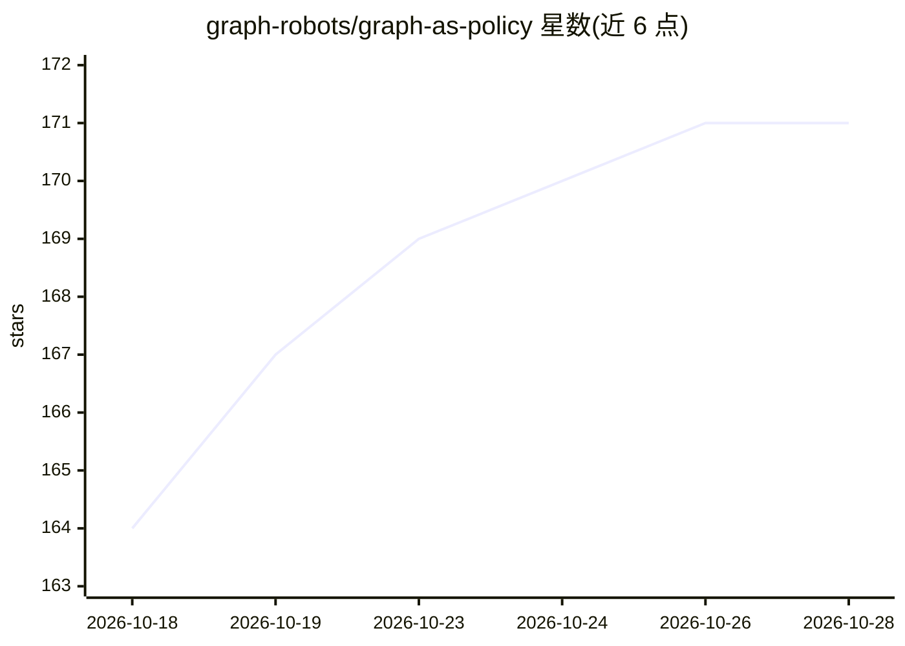

# graph-robots/graph-as-policy

⭐ 171 · Python · Apache-2.0 · 推送 2026-10-19 · [GitHub](https://github.com/graph-robots/graph-as-policy) · 组织维护

**把自然语言任务编译为经验证的机器人技能图并执行**

GaP 将自然语言任务指令编译成由模块化技能组成的带类型、经验证的计算图，在仿真中自我改进后部署到仿真器或真实机器人（Franka、UR5 等）执行。技能存放于兄弟仓库 open-robot-skills（Anthropic Agent Skills 格式，可贡献）。需要 1× RTX 4090（≥24GB VRAM）、LLM API key（OpenRouter/Vertex）与 HuggingFace token（SAM3 权重）。Python 3.10+，附带 11 个示例与 Claude Code 等 AI agent 集成技能。真实机器人操作前须阅读安全文档。

## 筛选速览

| 维度 | 判定 | 备注 |
|---|---|---|
| AI 角色 | `ai-native` | 本体是模型或模型工具 |
| 许可风险 | `permissive` | Apache-2.0 |
| 部署形态 | `None` |  |
| 模型依赖 | — | README 未给出锁定关系 |
| 硬件要求 | `gpu-24g` | |
| 安装摩擦 | `low` | 无编译、无系统依赖或容器化 |
| 成熟度 | `idea` | |

## 能力要点

- 自然语言任务编译为带类型、经验证的技能计算图
- 图在仿真中自我改进后在仿真器/真实机器人（Franka、UR5）上执行
- 技能库 open-robot-skills 采用 Anthropic Agent Skills 格式，可社区贡献
- 提供 Claude Code 等 AI agent 的技能插件与 11 个示例工程

## 适用场景

- 用自然语言生成并执行机器人操作任务图（如杂货打包、USB-C 插入）
- 在仿真中验证与改进机器人工作流后再上真机
- 通过 Claude Code 等 AI agent 对话式操作机器人任务

## 场景标签

 · 领域:机器人/具身智能

## 证据(README 行号)

> L8: not just solve once. It compiles a natural-language task into a typed, verified
> L9: computation graph of modular skills, self-improves it in simulation, and runs
> L38: **Requirements:** **1× NVIDIA RTX 4090 (≥24 GB VRAM, Linux + EGL)**, an

## 星数曲线

2026-10-18 164 → 2026-10-28 171（+7）

---
*卡片 v1 · prompt 1.4 · 生成 2026-10-23 · 置信度 high · 依据 README sha `f5e766d032d9` · [字段定义](../../DATASET.md)*
