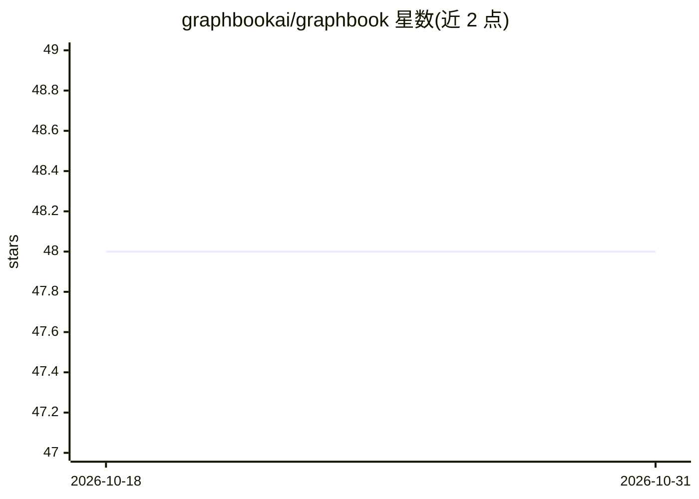

# graphbookai/graphbook

⭐ 48 · Python · MIT · 推送 2026-05-03 · [GitHub](https://github.com/graphbookai/graphbook) · [官网](https://docs.graphbook.ai/) · 组织维护

**可视化构建与运行 AI 数据管道的 Python 框架**

用于构建 DAG 结构化 AI 数据管道/工作流的 Python 框架，节点以 Python 编写，通过 Web UI 组装、监控与执行工作流。提供面向 PyTorch 张量的自动批处理、多进程 IO、输出缓存与增量重执行、节点级日志监控、human-in-the-loop 交互，并支持用 Ray 集群扩展。适用场景包括训练数据准备、模型实验与 ML ETL 应用。项目自述处于非常早期阶段，存在小 bug 与快速的设计变化。可经 pip 或 Docker 安装，Linux/macOS 受支持，Windows 不推荐。

## 筛选速览

| 维度 | 判定 | 备注 |
|---|---|---|
| AI 角色 | `ai-ecosystem` | LLM/agent 周边工具 |
| 许可风险 | `permissive` | MIT |
| 部署形态 | `self-host` | docker 或自建部署 |
| 模型依赖 | — | README 未给出锁定关系 |
| 硬件要求 | — | 无带数字的原话,不猜 |
| 安装摩擦 | `low` | 无编译、无系统依赖或容器化 |
| 成熟度 | `idea` | |

## 能力要点

- Web 图形化编辑器组装、监控、执行 ML 工作流
- PyTorch 张量自动批处理与多进程 IO
- 输出缓存，仅重执行变更部分的工作流
- 支持 Ray 集群扩展与第三方插件（BETA）

## 适用场景

- 清洗与整理大规模自定义数据集
- 在不同 ML 模型与超参数间快速实验
- 构建 no-code/低代码 ML 应用与 ETL 流程

## 场景标签

`工作流自动化` `MLOps` · 领域:效率与自动化

## 证据(README 行号)

> L44: Graphbook is a framework for building efficient, interactive DAG-structured AI data pipelines or workflows composed
> L31:  The Framework for AI-driven Data Pipelines

## 星数曲线

2026-10-18 48 → 2026-10-31 48（+0）

---
*卡片 v1 · prompt 1.4 · 生成 2026-10-25 · 置信度 high · 依据 README sha `94f168100d5c` · [字段定义](../../DATASET.md)*
