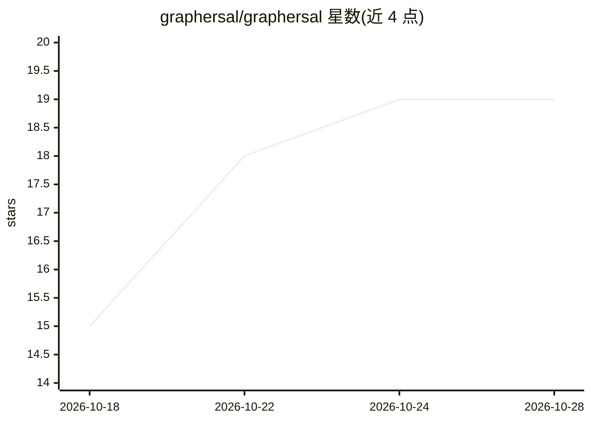

# graphersal/graphersal

⭐ 19 · Rust · Apache-2.0 · 推送 2026-10-28 · [GitHub](https://github.com/graphersal/graphersal) · [官网](https://graphersal.dev) · 个人维护

**Rust 内存图数据库与 Gremlin/GQL 遍历引擎，含向量检索**

用 Rust 实现的可嵌入内存图数据库：支持 GQL（ISO/IEC 39075，实验性）与 Gremlin 两种查询语言跑在同一引擎上；向量作为值类型存于图中，支持 nearest() 相似检索（cosine/dot/L2/Hamming）与量化，用于 GraphRAG。交付形态包括浏览器 Playground（WASM，数据不出浏览器）、CLI 与 REPL、本地服务器（HTTP + MCP 端点供 Claude Code 等 AI agent 查询图）、Rust 与 Python 绑定。提供权限、只读访问、超时限制与预写日志持久化。自我声明 0.3 为早期发布线。

## 筛选速览

| 维度 | 判定 | 备注 |
|---|---|---|
| AI 角色 | `ai-ecosystem` | LLM/agent 周边工具 |
| 许可风险 | `permissive` | Apache-2.0 |
| 部署形态 | `desktop` | 安装包/桌面程序 |
| 模型依赖 | — | README 未给出锁定关系 |
| 硬件要求 | — | 无带数字的原话,不猜 |
| 安装摩擦 | `medium` | 含编译或系统依赖之一 |
| 成熟度 | `idea` | |

## 能力要点

- GQL 与 Gremlin 双语言共用同一引擎与优化器
- 向量内嵌图 schema，一次遍历完成 GraphRAG 检索
- MCP 服务器让 AI agent 以 GQL/Gremlin 查询图
- 预写日志、时间点回溯、备份修复的持久化存储

## 适用场景

- 给 AI agent 通过 MCP 查询和操作知识图谱
- 构建 GraphRAG：向量近邻 + 图遍历一次完成
- 在 Rust 或 Python 应用中嵌入图数据库
- 浏览器中无安装地试验 Gremlin/GQL 查询

## 场景标签

`知识图谱` `RAG` `向量数据库` · 领域:知识与检索

## 证据(README 行号)

> L113: - **AI agents on your graph.** The server speaks the Model Context Protocol (MCP), so Claude Code or
> L23: It works out of the box: a browser UI, an MCP endpoint for AI agents, an AI chat where you simply
> L34: L2, Hamming). **GraphRAG** in one traversal: find the passages nearest to the question, then follow

## 星数曲线

2026-10-18 15 → 2026-10-28 19（+4）

---
*卡片 v1 · prompt 1.4 · 生成 2026-10-28 · 置信度 high · 依据 README sha `5ebeed90c34d` · [字段定义](../../DATASET.md)*
