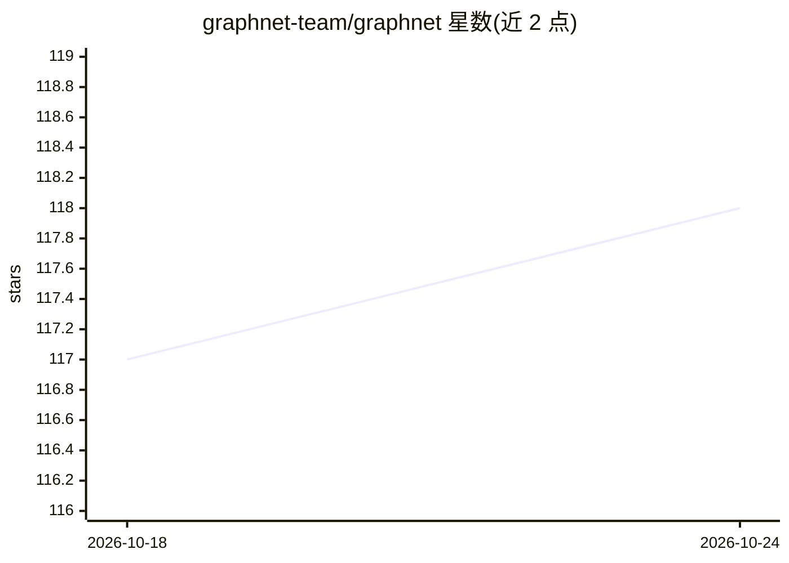

# graphnet-team/graphnet

⭐ 118 · Python · Apache-2.0 · 推送 2026-10-18 · [GitHub](https://github.com/graphnet-team/graphnet) · [官网](https://graphnet-team.github.io/graphnet/) · 组织维护

**中微子望远镜事件重建的深度学习 Python 框架**

GraphNeT 是面向中微子望远镜（IceCube、KM3NeT 等）的开源 Python 框架，用图神经网络完成探测器事件重建与分类任务，支持任意探测器配置下的模型训练与推理。提供重建挑战、实验与物理分析三类用例清单（低能/高能中微子分类重建、脉冲噪声清理、多类事件分类等），并列出多篇使用该框架的论文。兼容 Python 3.9-3.11、Linux/macOS，建议在独立虚拟环境安装；采用 Apache 2.0 许可，由欧盟 Horizon 2020 与 PUNCH4NFDI 资助。

## 筛选速览

| 维度 | 判定 | 备注 |
|---|---|---|
| AI 角色 | `ai-native` | 本体是模型或模型工具 |
| 许可风险 | `permissive` | Apache-2.0 |
| 部署形态 | `None` |  |
| 模型依赖 | — | README 未给出锁定关系 |
| 硬件要求 | — | 无带数字的原话,不猜 |
| 安装摩擦 | `low` | 无编译、无系统依赖或容器化 |
| 成熟度 | — | 结构信号不足 |

## 能力要点

- 图神经网络用于中微子望远镜事件重建与分类
- 支持任意探测器配置的端到端训练与推理
- 覆盖 IceCube、KM3NeT 等实验的用例与论文追踪
- 兼容 Python 3.9-3.11，Linux/macOS，Apache 2.0 许可

## 适用场景

- 在中微子望远镜实验中训练事件重建模型
- 做低能/高能中微子分类与重建研究
- 复现论文中的图神经网络物理分析流程

## 场景标签

`模型训练` · 领域:训练与推理

## 证据(README 行号)

> L13: **GraphNeT** is an open-source Python framework aimed at providing high quality, user friendly, end-to-end function

## 星数曲线

2026-10-18 117 → 2026-10-24 118（+1）

---
*卡片 v1 · prompt 1.4 · 生成 2026-10-23 · 置信度 high · 依据 README sha `ebdf8da9be5b` · [字段定义](../../DATASET.md)*
