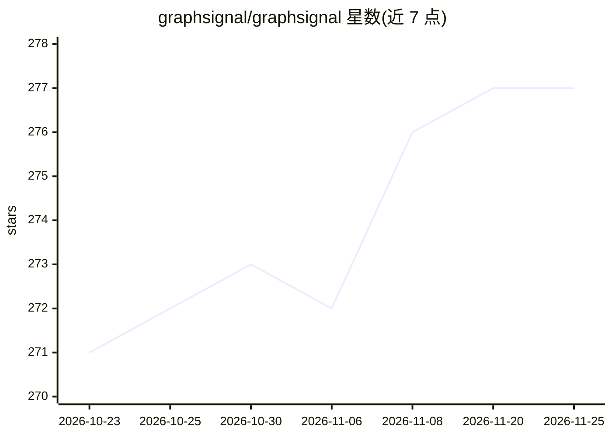

# graphsignal/graphsignal

⭐ 277 · Python · Apache-2.0 · 推送 2026-11-19 · [GitHub](https://github.com/graphsignal/graphsignal) · [官网](https://graphsignal.com) · 组织维护

**AI agent 可调用的 GPU 推理性能 profiler，本地侧车采集分析**

以侧车进程观察推理引擎或任意 GPU 应用的 GPU profiler，用于让 AI agent 自主执行性能优化循环：采集 GPU 活动（CUPTI/ROCm 注入，按 kernel/CUDA graph/memcpy 计时）、NVML/AMD SMI 遥测、进程与主机指标，并通过本地 /signals JSON API 与 /metrics Prometheus 端点暴露。默认完全本地运行，仅在设置 API key 后上传数据。通过 graphsignal-run 包装启动命令，附 graphsignal-top 终端视图与可内嵌的 C++ probe 头文件。

## 筛选速览

| 维度 | 判定 | 备注 |
|---|---|---|
| AI 角色 | `ai-ecosystem` | LLM/agent 周边工具 |
| 许可风险 | `permissive` | Apache-2.0 |
| 部署形态 | `library` | 以包/库形式分发 |
| 模型依赖 | local-ok | 支持本地模型 |
| 硬件要求 | — | 无带数字的原话,不猜 |
| 安装摩擦 | `medium` | 含编译或系统依赖之一 |
| 成熟度 | — | 结构信号不足 |

## 能力要点

- CUPTI/ROCm 注入采集每 kernel、CUDA graph、memcpy/同步的累计耗时
- 本地 /signals JSON 端点供 agent 读取并闭环调整 flags/代码
- 附 SKILL.md 供 Claude Code 等 agent 自动安装运行读取
- graphsignal-top 终端实时视图与 Prometheus/Grafana 导出

## 适用场景

- 让 AI agent 自动分析并调优 vLLM/SGLang 服务延迟
- 排查推理服务中 kernel、传输或主机线程的耗时分布
- 将 GPU 指标接入现有 Prometheus/Grafana 监控栈

## 场景标签

`LLM 可观测性` · 领域:评测与运维

## 证据(README 行号)

> L3: Graphsignal is a GPU profiler for AI agents to autonomously optimize inference performance across models, engines, a
> L17: The default way to start is to give the profiler's skill to an AI agent — the skill is self-contained, so the agent
> L93: The endpoint is what closes the loop: an AI agent launches the workload under `graphsignal-run`, polls `/signals` u

## 星数曲线

2026-10-23 271 → 2026-11-25 277（+6）

---
*卡片 v1 · prompt 1.4 · 生成 2026-11-25 · 置信度 high · 依据 README sha `28d4c72c5821` · [字段定义](../../DATASET.md)*
