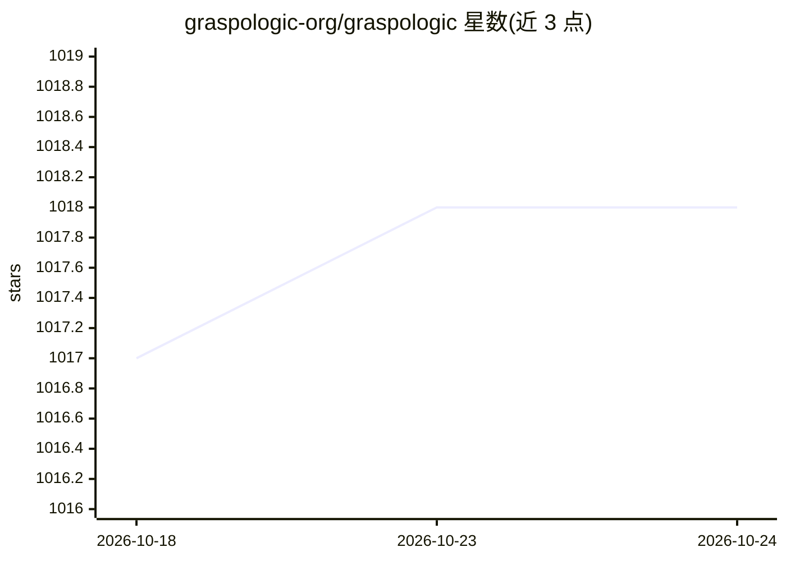

# graspologic-org/graspologic

⭐ 1,018 · Python · MIT · 推送 2026-06-18 · [GitHub](https://github.com/graspologic-org/graspologic) · [官网](https://graspologic-org.github.io/graspologic/) · 组织维护

**面向图数据的图统计分析 Python 库**

graspologic 是一个提供图统计算法与工具的 Python 包，用于处理和分析具有节点关系结构的数据（如社交网络）。它提供针对图的专用统计算法与实用工具，以弥补传统统计方法忽略节点空间排布信息的不足。面向科研与数据科学开发者，仅需标准计算机与足够内存即可运行，支持 Linux/macOS/Windows x64 与 Python 3.9-3.12（x86_64），通过 pip 安装，配套官方文档与教程，建议引用 GraSPy 论文。

## 筛选速览

| 维度 | 判定 | 备注 |
|---|---|---|
| AI 角色 | `ai-native` | 本体是模型或模型工具 |
| 许可风险 | `permissive` | MIT |
| 部署形态 | `library` | 以包/库形式分发 |
| 模型依赖 | — | README 未给出锁定关系 |
| 硬件要求 | — | 无带数字的原话,不猜 |
| 安装摩擦 | `low` | 无编译、无系统依赖或容器化 |
| 成熟度 | — | 结构信号不足 |

## 能力要点

- 提供图统计专用算法与图处理工具集
- 支持 Linux/macOS/Windows x64，Python 3.9-3.12
- pip 安装，附官方文档与教程
- 可引用 JMLR 发表的 GraSPy 论文

## 适用场景

- 对社交网络等关系型数据做图统计分析
- 在科研工作中用 Python 处理图结构数据并引用论文
- 数据分析项目中替代传统统计方法处理图数据

## 场景标签

 · 领域:图统计/网络科学

## 证据(README 行号)

> L8: ## `graspologic` is a package for graph statistical algorithms.
> L13: A graph, or network, provides a mathematically intuitive representation of data with some sort of relationship betw
> L69: > Chung, J., Pedigo, B. D., Bridgeford, E. W., Varjavand, B. K., Helm, H. S., & Vogelstein, J. T. (2019). GraSPy: G

## 星数曲线

2026-10-18 1,017 → 2026-10-24 1,018（+1）

---
*卡片 v1 · prompt 1.4 · 生成 2026-10-21 · 置信度 high · 依据 README sha `e075d3f88d42` · [字段定义](../../DATASET.md)*
