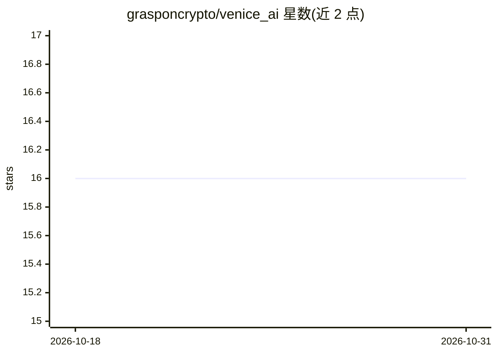

# grasponcrypto/venice_ai

⭐ 16 · Python · MIT · 推送 2026-10-30 · [GitHub](https://github.com/grasponcrypto/venice_ai) · 个人维护

**Home Assistant 对话集成：接入 Venice AI 控制智能家居**

为 Home Assistant 提供的自定义组件，通过 Venice AI API 接入大模型，实现自然语言智能家居指令理解与对话。模型列表自动过滤为支持 function calling 的模型，默认 Llama 3.3 70B；推理模型可关闭 thinking 降低延迟。安装支持 HACS 或手动复制到 custom_components；配置需填入 Venice AI API key。运行后提供对话 Agent、AI Task 实体、TTS 实体与请求统计传感器，参数可免重启重配。

## 筛选速览

| 维度 | 判定 | 备注 |
|---|---|---|
| AI 角色 | `ai-native` | 本体是模型或模型工具 |
| 许可风险 | `permissive` | MIT |
| 部署形态 | `None` |  |
| 模型依赖 | — | README 未给出锁定关系 |
| 硬件要求 | — | 无带数字的原话,不猜 |
| 安装摩擦 | `low` | 无编译、无系统依赖或容器化 |
| 成熟度 | — | 结构信号不足 |

## 能力要点

- 自然语言智能家居指令与对话 Agent，可加入 Assist 管线
- 自动过滤仅显示支持 function calling 的模型（默认 Llama 3.3 70B）
- 提供 AI Task 结构化数据生成与 TTS 语音合成实体
- 传感器报告请求次数、token 用量与最近错误

## 适用场景

- 在 Home Assistant 中用自然语言控制智能设备
- 将 Venice AI 模型用于仪表盘、脚本与自动化的结构化数据生成
- 通过 Venice 音频模型为媒体播放器提供语音播报

## 场景标签

`语音合成` · 领域:内容生成

## 证据(README 行号)

> L5: The Venice AI integration allows you to enhance your Home Assistant setup with advanced conversational capabilities 
> L61: * **Conversation agent** — A "Venice AI" agent appears in Settings → Voice Assistants → Expose, and can be selected
> L63: * **Text-to-speech** — A `tts.venice_ai_<entry_id>` entity streams synthesized speech from Venice's audio models fo

## 星数曲线

2026-10-18 16 → 2026-10-31 16（+0）

---
*卡片 v1 · prompt 1.4 · 生成 2026-10-30 · 置信度 high · 依据 README sha `f93785185682` · [字段定义](../../DATASET.md)*
