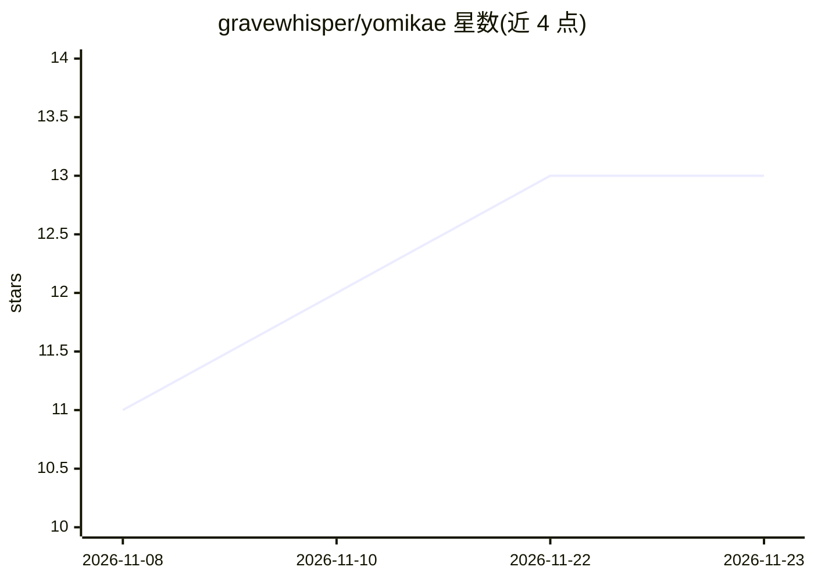

# gravewhisper/yomikae

⭐ 13 · Python · MIT · 推送 2026-11-22 · [GitHub](https://github.com/gravewhisper/yomikae) · 个人维护

**浏览器内日文漫画原位翻译工具：OCR+LLM+图像修复**

由 Chrome MV3 扩展与本地 Python 服务器组成：扩展将页面图像发送到本机服务器，服务器依次执行文本检测（comic-text-detector）、气泡分割（YOLO11）、日文识别（manga-ocr）、翻译（本地 LLM / Claude / Codex 三种可选后端）、LaMa 模型擦除原文并排入英文。支持 pixiv 与 X 的内置适配器、点击翻译模式、角色表（cast sheet）、逐气泡重译与报错标注，翻译结果缓存到磁盘。仅支持日语到英语，拟声词不翻译；Linux 为唯一受测系统。

## 筛选速览

| 维度 | 判定 | 备注 |
|---|---|---|
| AI 角色 | `ai-native` | 本体是模型或模型工具 |
| 许可风险 | `viral` | MIT |
| 部署形态 | `library` | 以包/库形式分发 |
| 模型依赖 | locked-api |  |
| 硬件要求 | — | 无带数字的原话,不猜 |
| 安装摩擦 | `high` | 编译与系统依赖俱全 |
| 成熟度 | — | 结构信号不足 |

## 能力要点

- 四阶段图像流水线：检测、气泡分割、OCR、LaMa 修复后原位嵌入英文
- 三种翻译后端可选：本地 LLM（LM Studio + OpenAI 兼容接口）、Claude、Codex，页面图像始终不出本机
- pixiv 与 X 内置适配器，携带前两页与角色名作为翻译上下文
- 逐气泡重译、提示词修正与角色表统一译名

## 适用场景

- 在 Chrome 里阅读 pixiv/X 上的日文生肉漫画时原位看英文
- 用本地 LLM 后端离线翻译、页面图像不外传
- 对个别气泡重译或补充人名提示
- 为其他站点编写适配器接入翻译流程

## 场景标签

`OCR` `图像视频处理` · 领域:感知与多模态

## 证据(README 行号)

> L11: Yomikae translates raw Japanese manga into English while you read it in Chrome. A browser extension sends each page
> L179: 1. comic-text-detector finds the text blocks and a mask of the lettering.
> L194: Yomikae translates Japanese into English only. It leaves sound effects drawn into the art untranslated on purpose.

## 星数曲线

2026-11-08 11 → 2026-11-23 13（+2）

---
*卡片 v1 · prompt 1.4 · 生成 2026-11-18 · 置信度 mid · 依据 README sha `1c7fb64498d8` · [字段定义](../../DATASET.md)*
