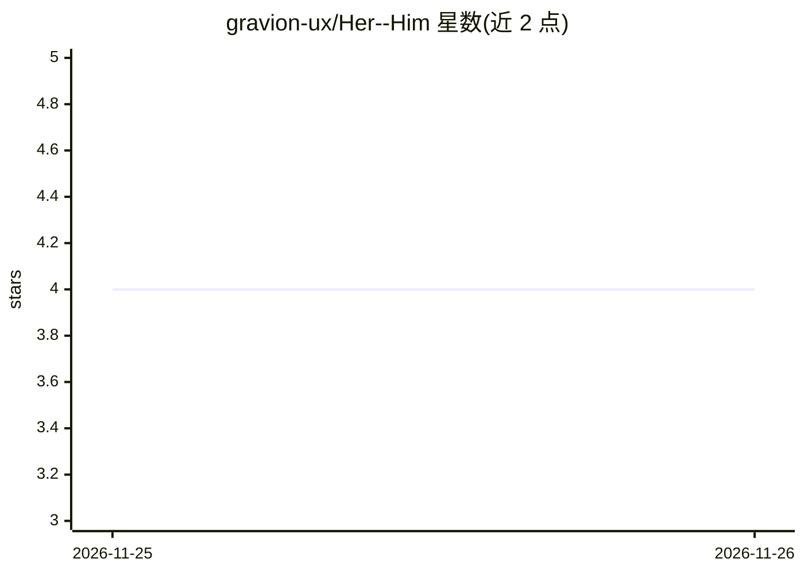

# gravion-ux/Her--Him

⭐ 4 · Python · MIT · 推送 2026-11-25 · [GitHub](https://github.com/gravion-ux/Her--Him) · 个人维护

**面向消费者的 AI 伴侣人格目录：48 个人格与情绪引擎**

包含女性（Her，24 个）与男性（Him，24 个）两组共 48 个 AI 伴侣人格目录，每条人格为 Character Card v3 文档，由确定性、可解释的情感引擎驱动：按轮次追踪 valence/arousal 等情感状态、派生 18 种情绪标签、11 轴人格特质与关系状态，并将情绪映射到 332 个多语言语音参数。提供 CLI、Python API 与 Web 服务器三种使用方式；核心包零运行时依赖，加载时校验成人范围、禁止未成年与同意护栏。MIT 许可。

## 筛选速览

| 维度 | 判定 | 备注 |
|---|---|---|
| AI 角色 | `ai-native` | 本体是模型或模型工具 |
| 许可风险 | `permissive` | MIT |
| 部署形态 | `library` | 以包/库形式分发 |
| 模型依赖 | — | README 未给出锁定关系 |
| 硬件要求 | — | 无带数字的原话,不猜 |
| 安装摩擦 | `low` | 无编译、无系统依赖或容器化 |
| 成熟度 | — | 结构信号不足 |

## 能力要点

- 48 个人格（Her 24 + Him 24），Character Card v3 格式
- 确定性、可解释的情感引擎，情绪按轮次可预测演化
- 332 个多语言语音（英/中/日/韩等），参数随情绪状态映射
- 零运行时依赖；内置成人范围校验与同意护栏

## 适用场景

- 浏览并挑选 AI 伴侣人格目录
- 为聊天机器人应用接入带情绪状态的人格
- 生成随情绪变化的多语言伴侣语音

## 场景标签

`聊天机器人` · 领域:对话与助手

## 证据(README 行号)

> L10: A unified platform with a complete catalogue of AI personalities for boys and girls, featuring natural multilingual
> L22: - **Deterministic affect engine**: Predictable mood and emotion evolution turn-to-turn
> L24: - **Multilingual support**: 332 voices across English, Mandarin, Japanese, Korean, Spanish, Portuguese, Hindi, and 

## 星数曲线

2026-11-25 4 → 2026-11-26 4（+0）

---
*卡片 v1 · prompt 1.4 · 生成 2026-11-24 · 置信度 high · 依据 README sha `06b2967c3d26` · [字段定义](../../DATASET.md)*
