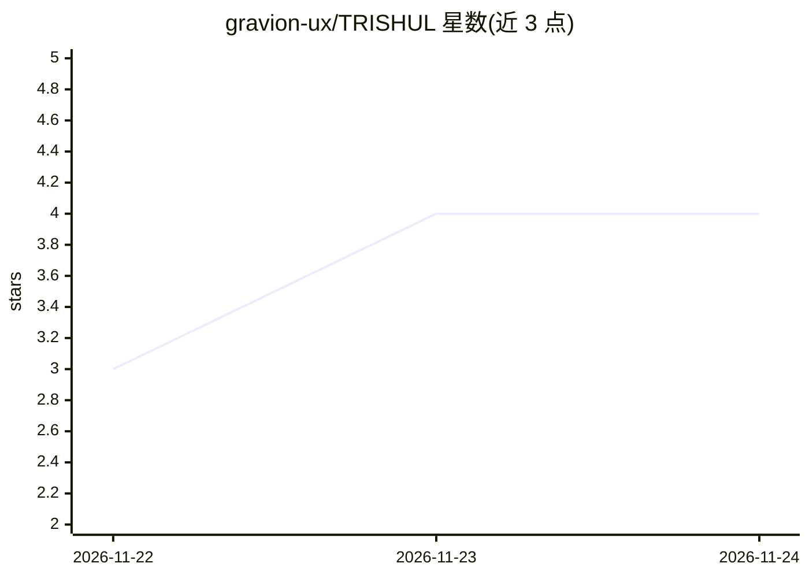

# gravion-ux/TRISHUL

⭐ 4 · Python · MIT · 推送 2026-11-23 · [GitHub](https://github.com/gravion-ux/TRISHUL) · 个人维护

**面向授权安全测试者的 AI 驱动漏洞扫描平台**

TRISHUL 是一个授权范围内的 AI 安全测试平台，按 Recon→Scan→Fuzz→Detect→Verify→PoC→Guide→Report 八阶段流水线执行测试，调用 httpx、nuclei、ffuf、nmap 四个外部二进制工具并保留原始输出作为证据。提供 LOCAL（本地 Ollama/LM Studio/llama.cpp，无需 API key，可完全离线）与 PROVIDER（OpenAI/Anthropic/Gemini/OpenAI-compatible）两个版本，运行时切换。AI 负责严重度评级、解释与报告；模型不可达时回退到确定性证据分数。内置授权确认、范围强制、默认非破坏性等安全门控，前后端同进程服务，React 仪表盘预构建随包分发。

## 筛选速览

| 维度 | 判定 | 备注 |
|---|---|---|
| AI 角色 | `ai-native` | 本体是模型或模型工具 |
| 许可风险 | `permissive` | MIT |
| 部署形态 | `library` | 以包/库形式分发 |
| 模型依赖 | local-ok | 支持本地模型 |
| 硬件要求 | — | 无带数字的原话,不猜 |
| 安装摩擦 | `low` | 无编译、无系统依赖或容器化 |
| 成熟度 | — | 结构信号不足 |

## 能力要点

- 调用 httpx/nuclei/ffuf/nmap 真实二进制并保留原始输出作证据
- 本地版基于 Ollama/LM Studio/llama.cpp，安装后可完全离线
- 授权确认、范围强制与非破坏性默认策略在代码层执行
- AI 不可达时以确定性 baseline_confidence 分数回退

## 适用场景

- 对授权目标执行自动化侦察与漏洞扫描
- 生成 JSON/Markdown/HTML 及 bug bounty 风格报告
- 气隙或敏感环境中本地运行安全测试流程

## 场景标签

`网络安全` · 领域:学习与行业

## 证据(README 行号)

> L3: **TRISHUL** is an authorized-scope, AI-powered security testing platform. It runs a real
> L51: - **Eight-stage pipeline.** `Recon → Scan → Fuzz → Detect → Verify → PoC → Guide → Report`.
> L55: - **AI with full authority over verdicts.** Severity, confidence (0–100) and the verified

## 星数曲线

2026-11-22 3 → 2026-11-24 4（+1）

---
*卡片 v1 · prompt 1.4 · 生成 2026-11-22 · 置信度 mid · 依据 README sha `78339194172e` · [字段定义](../../DATASET.md)*
