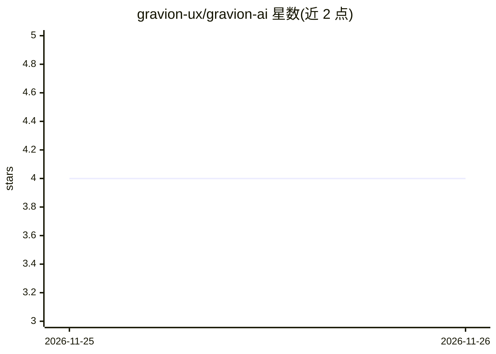

# gravion-ux/gravion-ai

⭐ 4 · Python · MIT · 推送 2026-11-25 · [GitHub](https://github.com/gravion-ux/gravion-ai) · 个人维护

**为初创公司提供的模块化 AI 平台，含许可与身份层**

面向初创公司的 Python 模块化 AI 平台：提供 chat、support、coder、website-builder、music、image、video、cyber、agentic 与 all-in-one 共 10 个模块，按四个训练就绪层级（Complete/Basic/Intermediate/Advanced）打包，统一在命名、公司策略注入、签名许可与身份层之下。开发模式免许可、可在内置 Gravion Core 离线引擎运行；生产运行需签署商业协议（含 10–20% 股权条款），部署带 Ed25519 加密身份与哈希链审计日志。不含训练好的模型权重托管，训练需自建流水线。

## 筛选速览

| 维度 | 判定 | 备注 |
|---|---|---|
| AI 角色 | `ai-ecosystem` | LLM/agent 周边工具 |
| 许可风险 | `permissive` | MIT |
| 部署形态 | `library` | 以包/库形式分发 |
| 模型依赖 | — | README 未给出锁定关系 |
| 硬件要求 | — | 无带数字的原话,不猜 |
| 安装摩擦 | `low` | 无编译、无系统依赖或容器化 |
| 成熟度 | `idea` | |

## 能力要点

- 10 个模块（chat/coder/image/video/music 等）按 4 个就绪层级打包
- 开发模式免许可、完全离线运行于内置 Gravion Core 引擎
- Ed25519 加密身份 + 签名许可 + 哈希链审计日志的技术执行层
- 带权限管控的自升级服务与数据集准备流水线（gravion train prepare）

## 适用场景

- 以自己的品牌名运行一套多模块 AI 产品
- 在公司策略注入下部署客服/编程/建站等 AI 助手
- 对客户数据做微调前的数据集清洗与划分

## 场景标签

`AI 助手` · 领域:对话与助手

## 证据(README 行号)

> L8: **Gravion AI — one modular AI platform, every kind of AI a startup needs, ready to rename, re-policy and run as your
> L11: before the first useful answer. Gravion AI is the base they should start
> L119: Modules are sold/used individually (variant packages) or together

## 星数曲线

2026-11-25 4 → 2026-11-26 4（+0）

---
*卡片 v1 · prompt 1.4 · 生成 2026-11-24 · 置信度 mid · 依据 README sha `0aee58136e95` · [字段定义](../../DATASET.md)*
