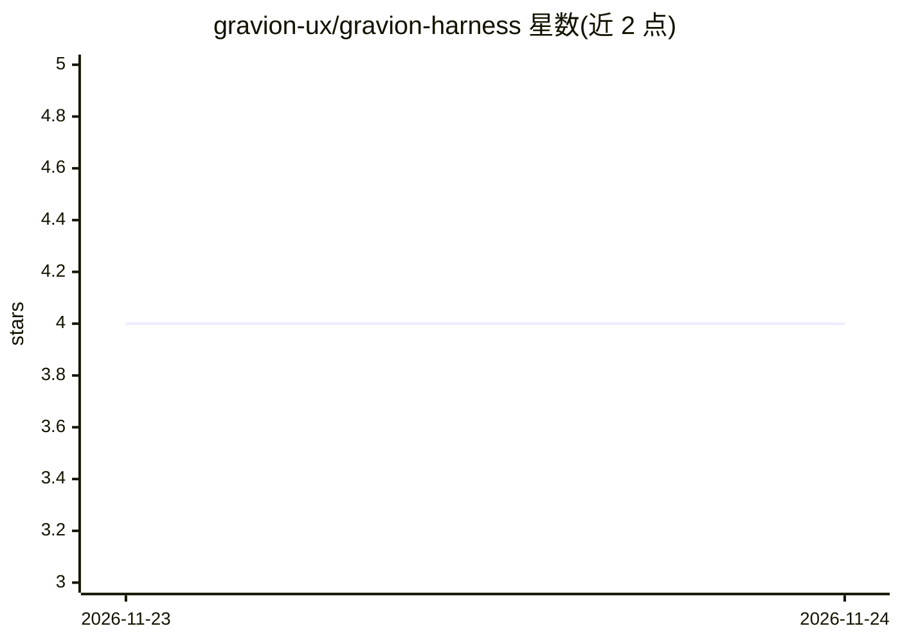

# gravion-ux/gravion-harness

⭐ 4 · JavaScript · MIT · 推送 2026-11-22 · [GitHub](https://github.com/gravion-ux/gravion-harness) · 个人维护

**授权范围内的 AI 辅助安全测试工具，沙箱执行并留审计链**

一个仅针对已授权目标的 AI 辅助安全测试工具：用户提供目标清单、目标描述与 provider，由模型提出测试步骤，引擎按 scope/deny 规则过滤、自评风险分级，沙箱执行后生成带原始响应证据的 findings，并写入哈希链式 JSONL 审计日志。提供 ask/smart/full 三种访问模式控制审批策略。零运行时依赖，仅需 Node >= 18；默认使用内置离线规划器，可切换 OpenAI/Anthropic 兼容 API。仅支持授权测试用途，沙箱非操作系统级隔离。

## 筛选速览

| 维度 | 判定 | 备注 |
|---|---|---|
| AI 角色 | `ai-enhanced` | 去掉 AI 部分产品仍成立 |
| 许可风险 | `permissive` | MIT |
| 部署形态 | `library` | 以包/库形式分发 |
| 模型依赖 | local-ok | 支持本地模型 |
| 硬件要求 | — | 无带数字的原话,不猜 |
| 安装摩擦 | `low` | 无编译、无系统依赖或容器化 |
| 成熟度 | — | 结构信号不足 |

## 能力要点

- scope/deny 规则由引擎裁决，越界步骤在执行前被丢弃
- ask/smart/full 三种访问模式与 deny 规则最高优先级
- 哈希链式 JSONL 审计日志，篡改可检测
- 零运行时依赖，仅用 Node 内置模块（Node >= 18）

## 适用场景

- 对自有或授权的 Web 目标做自动化安全检查
- 红队工作中留下可验证的决策审计记录
- 在沙箱边界内运行模型提出的测试步骤

## 场景标签

`网络安全` · 领域:学习与行业

## 证据(README 行号)

> L3: An AI-assisted security testing harness that runs **only** against targets you
> L15: **Zero runtime dependencies.** Node built-ins only. Node >= 18.
> L107: The offline planner is the default and the one used by the test suite. Point

## 星数曲线

2026-11-23 4 → 2026-11-24 4（+0）

---
*卡片 v1 · prompt 1.4 · 生成 2026-11-23 · 置信度 high · 依据 README sha `a29c590e96db` · [字段定义](../../DATASET.md)*
