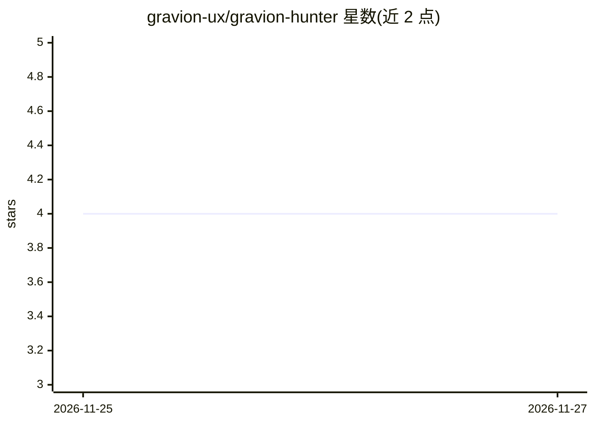

# gravion-ux/gravion-hunter

⭐ 4 · Python · MIT · 推送 2026-11-26 · [GitHub](https://github.com/gravion-ux/gravion-hunter) · 个人维护

**面向授权赏金猎人的自主漏洞挖掘 agent 框架**

以有效性比例而非提交数量为目标的自主 bug bounty agent 框架。核心机制：范围锁定（driver 强制解析并执行 scope.md，越界条目无法创建）、7 问验证门（状态机硬门禁，任一问题不过即淘汰线索）、去重优先（至少 3 个去重来源记录才可推进）、有效性刹车（N/A+重复率超阈值自动停止 autopilot）。流水线含 queued→reported 等状态，8 个 agent 角色分工执行侦察、验证、链式组合与报告撰写。仅限授权测试使用。

## 筛选速览

| 维度 | 判定 | 备注 |
|---|---|---|
| AI 角色 | `ai-native` | 本体是模型或模型工具 |
| 许可风险 | `permissive` | MIT |
| 部署形态 | `library` | 以包/库形式分发 |
| 模型依赖 | — | README 未给出锁定关系 |
| 硬件要求 | — | 无带数字的原话,不猜 |
| 安装摩擦 | `low` | 无编译、无系统依赖或容器化 |
| 成熟度 | — | 结构信号不足 |

## 能力要点

- scope 由 driver 强制执行，越界条目物理上无法创建
- 7 问验证门为状态机硬门禁，全部通过才能进入 reported
- 至少 3 个去重来源记录的强制去重转换
- 有效性刹车：N/A+重复率超 30% 自动中止 autopilot

## 适用场景

- 在已接受 scope 的 bug bounty 项目中自主挖掘漏洞
- 约束 agent 只做范围内的授权安全测试
- 提高提交报告的有效率而非数量

## 场景标签

`Agent 框架` `网络安全` · 领域:Agent 开发

## 证据(README 行号)

> L3: **Autonomous bug bounty agent framework — built for validity ratio, not volume.**
> L17: |Validation|A checklist in a prompt|A **state machine gate**: a finding cannot reach `reported` until all 7 gate qu

## 星数曲线

2026-11-25 4 → 2026-11-27 4（+0）

---
*卡片 v1 · prompt 1.4 · 生成 2026-11-24 · 置信度 high · 依据 README sha `23bc64219892` · [字段定义](../../DATASET.md)*
