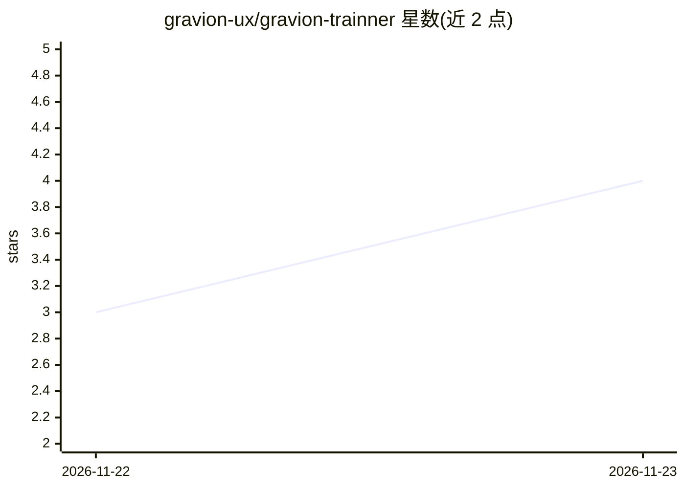

# gravion-ux/gravion-trainner

⭐ 4 · Python · MIT · 推送 2026-11-22 · [GitHub](https://github.com/gravion-ux/gravion-trainner) · 组织维护

**对 OpenAI 兼容端点运行 JSONL 数据集评测的启发式冒烟测试工具**

一个模型质量评测起步工具：读取 JSONL 数据集，通过 OpenAI 兼容的 chat-completions 端点调用模型，检查每条回复是否包含预期短语并输出启发式关键词覆盖率报告。仅依赖 Python 标准库，支持本地运行时与托管服务（用环境变量配置 base URL 与 API key）。作者明确定位为冒烟测试而非通用智能评分，不涉及模型再训练，建议在上线晋级模型前补充基于规则 rubric、事实性检查、人工评审等更完整的评测。

## 筛选速览

| 维度 | 判定 | 备注 |
|---|---|---|
| AI 角色 | `ai-ecosystem` | LLM/agent 周边工具 |
| 许可风险 | `permissive` | MIT |
| 部署形态 | `library` | 以包/库形式分发 |
| 模型依赖 | — | README 未给出锁定关系 |
| 硬件要求 | — | 无带数字的原话,不猜 |
| 安装摩擦 | `low` | 无编译、无系统依赖或容器化 |
| 成熟度 | `idea` | |

## 能力要点

- 读取 JSONL 数据集，经 OpenAI 兼容 chat 端点评测模型回复
- 检查预期短语并输出启发式关键词覆盖率报告
- 仅依赖标准库，pip install -e . 源码安装即可运行
- 支持本地运行时与托管服务商，凭据经环境变量注入

## 适用场景

- 给本地模型做上线前的快速冒烟测试
- 对多个候选模型跑同一 JSONL 数据集比较关键词覆盖率
- 作为团队评测流水线的起步脚手架，再扩展 rubric 与人工评审

## 场景标签

`模型评测` · 领域:评测与运维

## 证据(README 行号)

> L3: Model quality evaluation starter for OpenAI-compatible chat-completions endpoints (including compatible local runtim
> L12: python -m gravion_trainner.cli evaluate --dataset data/sample.jsonl --output reports/report.json

## 星数曲线

2026-11-22 3 → 2026-11-23 4（+1）

---
*卡片 v1 · prompt 1.4 · 生成 2026-11-22 · 置信度 high · 依据 README sha `c9a4d43ff4ac` · [字段定义](../../DATASET.md)*
