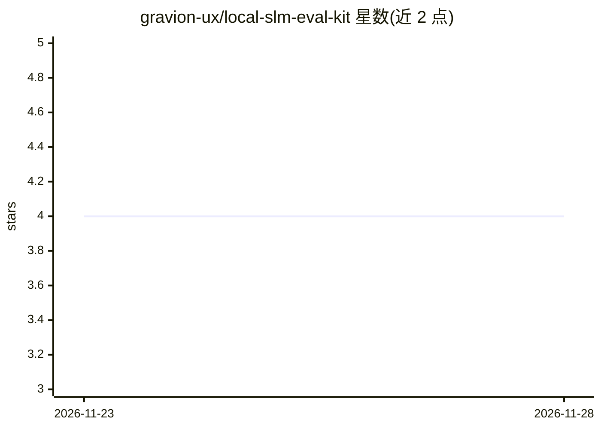

# gravion-ux/local-slm-eval-kit

⭐ 4 · JavaScript · MIT · 推送 2026-11-26 · [GitHub](https://github.com/gravion-ux/local-slm-eval-kit) · 个人维护

**对本地小语言模型运行可复现评测套件并生成报告的 CLI 工具**

面向本地部署的小语言模型运行评测套件：内置 10 个任务（指令遵循、格式、安全、推理）与 6 种打分器，通过用户提供的命令适配器调用模型，不绑定特定运行时。评测过程带超时与脱敏步骤，对模型输出中的密钥、令牌、邮箱等做掩码处理；输出键序稳定的 JSON 报告与 Markdown 报告，可在多次运行间 diff。零运行时依赖，仅要求 Node 18+，本身不下载模型。

## 筛选速览

| 维度 | 判定 | 备注 |
|---|---|---|
| AI 角色 | `ai-ecosystem` | LLM/agent 周边工具 |
| 许可风险 | `permissive` | MIT |
| 部署形态 | `library` | 以包/库形式分发 |
| 模型依赖 | local-ok | 支持本地模型 |
| 硬件要求 | — | 无带数字的原话,不猜 |
| 安装摩擦 | `low` | 无编译、无系统依赖或容器化 |
| 成熟度 | — | 结构信号不足 |

## 能力要点

- 命令适配器机制：通过模板调用任意本地模型运行时
- 内置 10 个任务与 6 种确定性打分器
- 模型输出写入报告前经过脱敏（密钥/令牌/邮箱掩码）
- JSON 报告键序稳定，支持跨运行 diff

## 适用场景

- 在本地机器上衡量某个小模型是否适合我的任务
- 对比不同运行方式下同一模型的评测结果
- 在 CI 中对本地模型做回归评测

## 场景标签

`模型评测` · 领域:评测与运维

## 证据(README 行号)

> L5: Runs a repeatable evaluation suite against a **local** small language model.
> L9: runtime. It talks to the model through a **command adapter**: a command template you supply,
> L21: time. That is what this kit provides.

## 星数曲线

2026-11-23 4 → 2026-11-28 4（+0）

---
*卡片 v1 · prompt 1.4 · 生成 2026-11-23 · 置信度 high · 依据 README sha `044626025945` · [字段定义](../../DATASET.md)*
