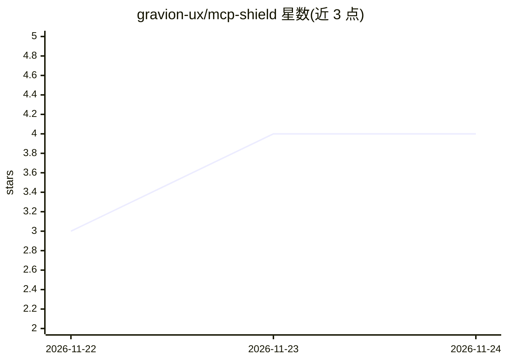

# gravion-ux/mcp-shield

⭐ 4 · Python · MIT · 推送 2026-11-22 · [GitHub](https://github.com/gravion-ux/mcp-shield) · 个人维护

**给 MCP 服务器做安全审计的 CLI：检测工具投毒与配置漂移**

针对 MCP 服务器配置与工具定义的静态安全审计工具：检测工具描述中的提示注入（含零宽/双向 Unicode 隐藏文本）、环境变量中的密钥泄漏、过宽的文件系统授权、未固定版本的执行命令等 14 类问题，并支持 SHA-256 基线固定与漂移检查（pin/check）以防御 rug pull。输出 Markdown 或 JSON 报告，含 0–100 风险分与修复建议，退出码可接入 CI。纯 Python 标准库实现，零运行时依赖，要求 Python 3.9+，以 pip 安装。面向在 Claude Desktop、Cursor、VS Code 等宿主中使用 MCP 的开发者与 DevSecOps 流程。

## 筛选速览

| 维度 | 判定 | 备注 |
|---|---|---|
| AI 角色 | `ai-ecosystem` | LLM/agent 周边工具 |
| 许可风险 | `permissive` | MIT |
| 部署形态 | `library` | 以包/库形式分发 |
| 模型依赖 | — | README 未给出锁定关系 |
| 硬件要求 | — | 无带数字的原话,不猜 |
| 安装摩擦 | `low` | 无编译、无系统依赖或容器化 |
| 成熟度 | — | 结构信号不足 |

## 能力要点

- 检测工具描述投毒与零宽/双向 Unicode 隐藏指令
- pin/check 基线机制用 SHA-256 指纹检测工具定义漂移（rug pull）
- 审计 env 中的真实 token 格式（ghp_、sk-、AKIA、PEM）与过宽授权
- 纯标准库零依赖，退出码适配 GitHub Actions CI

## 适用场景

- 把 MCP 配置粘贴进宿主前先做安全审计
- 在 CI 中检测 MCP 服务器更新后的定义漂移
- 审查团队共享的 MCP JSON 配置中的密钥泄漏与过宽授权

## 场景标签

`网络安全` · 领域:学习与行业

## 证据(README 行号)

> L5: **A defensive security auditor for MCP (Model Context Protocol) servers.**
> L7: `mcp-shield` statically audits MCP server configurations and tool definitions
> L10: into a foothold. Pure Python standard library: **zero runtime dependencies**.

## 星数曲线

2026-11-22 3 → 2026-11-24 4（+1）

---
*卡片 v1 · prompt 1.4 · 生成 2026-11-22 · 置信度 mid · 依据 README sha `306be898c746` · [字段定义](../../DATASET.md)*
