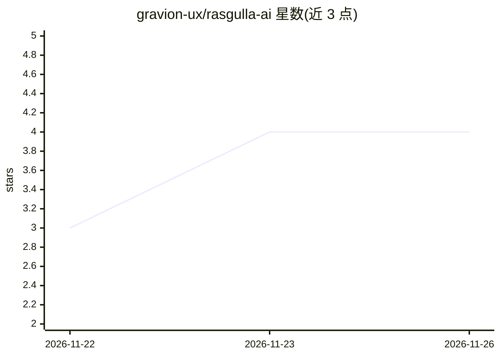

# gravion-ux/rasgulla-ai

⭐ 4 · Python · MIT · 推送 2026-11-25 · [GitHub](https://github.com/gravion-ux/rasgulla-ai) · 个人维护

**面向安全研究者的本地静态代码分析工作台**

以本地运行为先的安全研究工作台，提供源码清单、启发式风险提示与带文件/行号证据的可解释发现，并生成安全的本地测试计划。内置 RG001–RG006 六条规则覆盖动态求值、进程执行、TLS 校验关闭、硬编码密钥（报告中脱敏）、shell 启动子进程与不安全反序列化。命令行退出码规范化、不打印 traceback，可直接用于 CI；亦提供 Python API。静态适配器完全离线无需 API key，可按 ModelAdapter 协议接入其他模型。当前为 MVP 原型，仅做静态检查。

## 筛选速览

| 维度 | 判定 | 备注 |
|---|---|---|
| AI 角色 | `ai-native` | 本体是模型或模型工具 |
| 许可风险 | `permissive` | MIT |
| 部署形态 | `library` | 以包/库形式分发 |
| 模型依赖 | — | README 未给出锁定关系 |
| 硬件要求 | — | 无带数字的原话,不猜 |
| 安装摩擦 | `low` | 无编译、无系统依赖或容器化 |
| 成熟度 | `idea` | |

## 能力要点

- 六条内置规则（RG001–RG006）检测动态求值、不安全反序列化、TLS 校验关闭等
- 检测到的密钥值在报告中脱敏，不复制原始值
- 退出码规范化且不打印 traceback，可直接用于 CI 管道
- Provider-neutral 的 ModelAdapter 协议，静态适配器无需模型与网络

## 适用场景

- 扫描本地代码目录并输出带行号证据的安全发现
- 在 CI 中以 --fail-on-findings 阻断存在风险的提交
- 为可疑代码路径生成本地离线测试计划

## 场景标签

`代码审查` · 领域:编码与开发

## 证据(README 行号)

> L11: - Provider-neutral model adapter interface (no API key required for static mode).
> L27: rasgulla ./src                                # analyze a directory and print the report
> L46: |Rule|Severity|Detects|

## 星数曲线

2026-11-22 3 → 2026-11-26 4（+1）

---
*卡片 v1 · prompt 1.4 · 生成 2026-11-22 · 置信度 high · 依据 README sha `cd27e2569c4d` · [字段定义](../../DATASET.md)*
