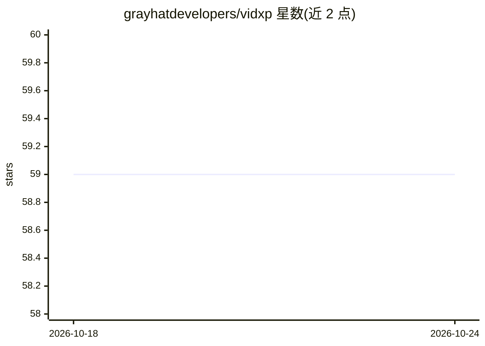

# grayhatdevelopers/vidxp

⭐ 59 · Python · MIT · 推送 2026-10-23 · [GitHub](https://github.com/grayhatdevelopers/vidxp) · 组织维护

**本地优先的视频语义搜索引擎：按语音、画面、人脸搜索视频**

VidXP 将单个或成批视频索引为可按语义搜索的库：支持语音、声音事件、视觉场景、多帧动作的描述式搜索，并可对视频中反复出现的人脸分组、导出高亮视频。搜索结果附带来源视频、时间戳、匹配分数与证据。使用方式包括桌面应用（Windows/Apple Silicon macOS/Linux）、CLI/Python 包、浏览器界面、HTTP API 与 MCP 服务器，可接入 Claude/Codex 等 AI 客户端。视频可保留在本机。MIT 许可，处于 beta 阶段。

## 筛选速览

| 维度 | 判定 | 备注 |
|---|---|---|
| AI 角色 | `ai-native` | 本体是模型或模型工具 |
| 许可风险 | `permissive` | MIT |
| 部署形态 | `self-host` | docker 或自建部署 |
| 模型依赖 | — | README 未给出锁定关系 |
| 硬件要求 | — | 无带数字的原话,不猜 |
| 安装摩擦 | `low` | 无编译、无系统依赖或容器化 |
| 成熟度 | `idea` | |

## 能力要点

- 语音/声音/场景/动作四类描述式搜索
- 人脸分组与演员高亮视频导出
- MCP 服务器接入 AI 客户端，返回可检视证据
- 桌面应用、CLI、浏览器、HTTP API 多种使用方式

## 适用场景

- 在家庭录像库里按回忆中的对话或画面找片段
- 把视频搜索能力接入剪辑工作流
- 让 AI agent 基于自己的视频库回答问题并给出证据

## 场景标签

`语义搜索` `多模态` `人脸识别` · 领域:知识与检索

## 证据(README 行号)

> L7:  Search video by what was said, what appeared on screen, and recurring faces.
> L28: - **Speech search:** type what you remember someone saying and jump to the
> L98: - Find speech, sound events, visual scenes, and multi-frame actions by description.

## 星数曲线

2026-10-18 59 → 2026-10-24 59（+0）

---
*卡片 v1 · prompt 1.4 · 生成 2026-10-24 · 置信度 high · 依据 README sha `a2047e082311` · [字段定义](../../DATASET.md)*
