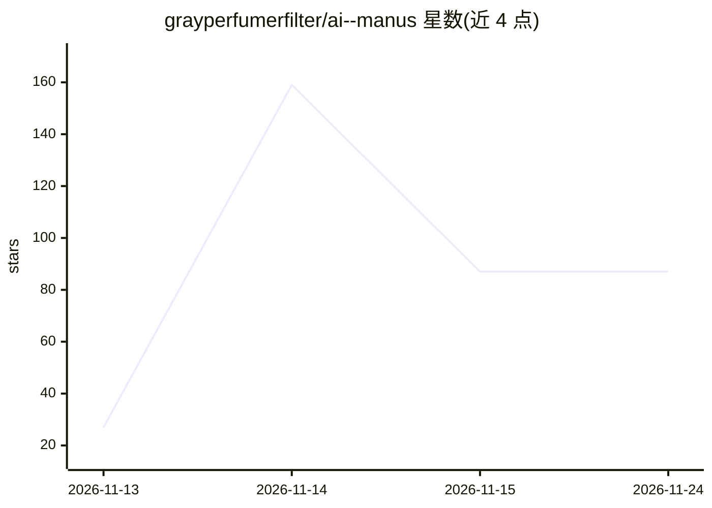

# grayperfumerfilter/ai--manus

⭐ 87 · Apache-2.0 · 推送 2026-11-15 · [GitHub](https://github.com/grayperfumerfilter/ai--manus) · 个人维护

**面向个人日常任务的自主 AI Agent：自动执行代码与浏览器操作**

Manus 是一个自主 AI Agent，代表用户编写并执行脚本、控制浏览器完成多步任务，定位为家庭、学习与轻量办公场景的助手而非企业平台。能力包括自主代码执行、浏览器控制（导航、填表、采集信息）、后台常驻与跨会话的任务模式记忆。README 给出硬件兼容表（最低 4 GB 内存、双核 CPU）与六步上手流程，但未提供具体安装命令、依赖清单或模型接入方式；仅出现下载入口与促销码 PROMO2026。

## 筛选速览

| 维度 | 判定 | 备注 |
|---|---|---|
| AI 角色 | `ai-native` | 本体是模型或模型工具 |
| 许可风险 | `permissive` | Apache-2.0 |
| 部署形态 | `None` |  |
| 模型依赖 | — | README 未给出锁定关系 |
| 硬件要求 | — | 无带数字的原话,不猜 |
| 安装摩擦 | `low` | 无编译、无系统依赖或容器化 |
| 成熟度 | — | 结构信号不足 |

## 能力要点

- 自主编写并执行代码完成任务
- 浏览器控制：导航网页、填写表单、采集信息
- 脚本与浏览器操作可在同一任务流中衔接
- 后台常驻的个人助手模式

## 适用场景

- 让 agent 代跑小脚本与快速实验
- 自动浏览多个网页收集资料并汇总
- 处理整理文件、查页等重复性日常琐事

## 场景标签

`AI 助手` `编码 Agent` `浏览器自动化` · 领域:效率与自动化

## 证据(README 行号)

> L10: - **Autonomous Code Execution:** Manus AI agent runs code on its own to complete tasks, so you can focus on decisio
> L18: Manus is an autonomous AI agent designed to run code and control a browser on your behalf. Instead of acting like a

## 星数曲线

2026-11-13 27 → 2026-11-24 87（+60）

---
*卡片 v1 · prompt 1.4 · 生成 2026-11-17 · 置信度 mid · 依据 README sha `0f78ee3a5dd2` · [字段定义](../../DATASET.md)*
