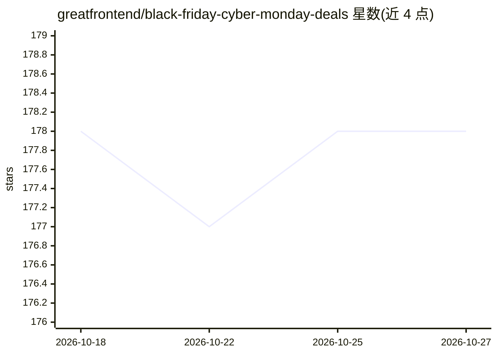

# greatfrontend/black-friday-cyber-monday-deals

⭐ 178 · 推送 2025-12-02 · [GitHub](https://github.com/greatfrontend/black-friday-cyber-monday-deals) · 组织维护

**面向开发者与设计师的黑五/网一优惠信息聚合清单**

由 GreatFrontEnd 维护的 2025 年黑五/网络星期一优惠聚合仓库：按技术面试准备、课程、UI 与模板套件、开发工具、AI 工具、设计套件等类别收录条目，每条含产品名称、描述、折扣码/折扣幅度与有效期，并通过 PR 接受社区投稿。面向软件工程师、开发者与设计师，用于在促销期间查找学习资源与工具折扣。仓库不提供软件本体，无可安装产物。

## 筛选速览

| 维度 | 判定 | 备注 |
|---|---|---|
| AI 角色 | `ai-knowledge` | 知识聚合/清单类 |
| 许可风险 | `none` | — |
| 部署形态 | `None` |  |
| 模型依赖 | — | README 未给出锁定关系 |
| 硬件要求 | — | 无带数字的原话,不猜 |
| 安装摩擦 | `low` | 无编译、无系统依赖或容器化 |
| 成熟度 | — | 结构信号不足 |

## 能力要点

- 按类别组织的 2025 年黑五/网一优惠表格（面试准备、课程、UI 套件、开发工具、书籍等）
- 每条优惠含折扣码、折扣幅度与截止日期
- 通过 pull request 接受社区提交的新优惠

## 适用场景

- 黑五/网一期间查找开发者课程与书籍的折扣码
- 浏览 UI 套件、模板与 SaaS 启动套件的促销信息
- 通过 PR 提交自己产品的优惠供社区发现

## 场景标签

`精选清单` · 领域:学习与行业

## 证据(README 行号)

> L3: Black Friday and Cyber Monday 2025 deals for software engineers, developers, and designers. Find discounts on techni
> L30: - 🤖 Jump to AI-powered tools

## 星数曲线

2026-10-18 178 → 2026-10-27 178（+0）

---
*卡片 v1 · prompt 1.4 · 生成 2026-10-22 · 置信度 high · 依据 README sha `0ec9dbb5fefd` · [字段定义](../../DATASET.md)*
