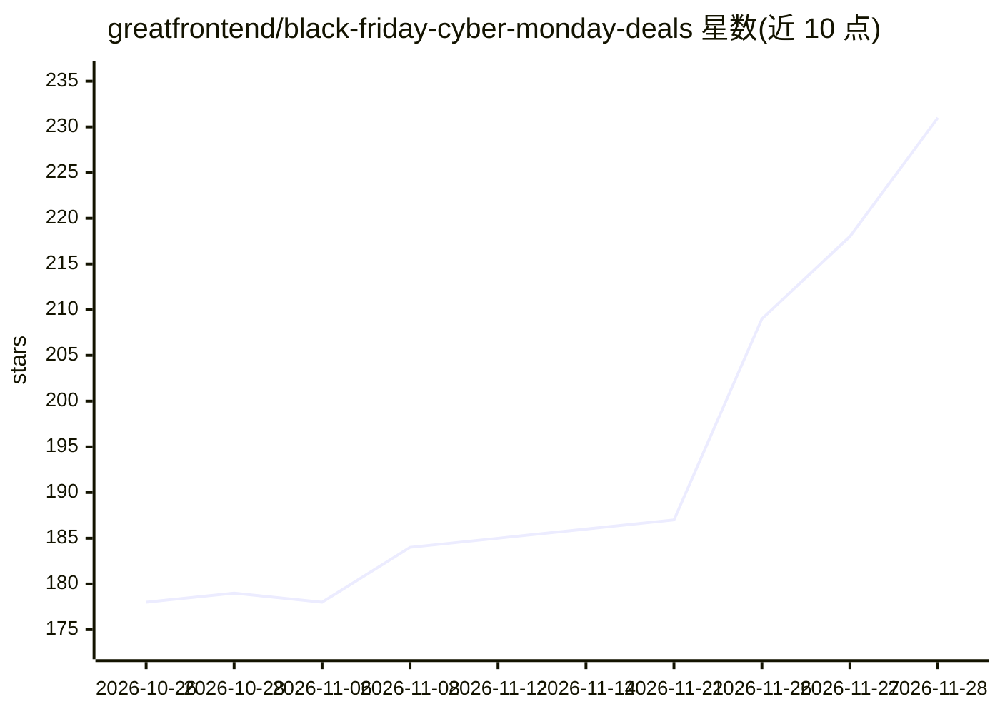

# greatfrontend/black-friday-cyber-monday-deals

⭐ 231 · TypeScript · 推送 2026-11-27 · [GitHub](https://github.com/greatfrontend/black-friday-cyber-monday-deals) · [官网](https://ctrlfriday.com) · 组织维护

**面向开发者与设计师的黑五/网一优惠清单**

由 GreatFrontEnd 维护的黑五与网一（Black Friday/Cyber Monday 2026）优惠聚合清单，覆盖面试准备平台、课程、UI/起始套件、开发工具、书籍、生产力工具、AI 工具与设计资源等类目。每个条目对应 data/deals/2026/ 下的一个 JSON 文件，README 中的表格由 JSON 生成；社区可通过 PR 或 issue 表单提交与更新条目。清单为纯静态编目，不含安装或运行本产品自身的步骤。

## 筛选速览

| 维度 | 判定 | 备注 |
|---|---|---|
| AI 角色 | `ai-knowledge` | 知识聚合/清单类 |
| 许可风险 | `none` | — |
| 部署形态 | `None` |  |
| 模型依赖 | — | README 未给出锁定关系 |
| 硬件要求 | — | 无带数字的原话,不猜 |
| 安装摩擦 | `low` | 无编译、无系统依赖或容器化 |
| 成熟度 | — | 结构信号不足 |

## 能力要点

- 条目以 JSON 文件存储，表格自动生成
- 覆盖面试准备、课程、UI 套件、开发工具、AI 工具等多个类目
- 支持 PR 与 issue 表单两种贡献方式
- 标注每条优惠的折扣码与有效期

## 适用场景

- 黑五期间查找开发工具与课程的折扣
- 查询面试准备资源的优惠码
- 为自己的产品提交黑五优惠条目

## 场景标签

`精选清单` · 领域:学习与行业

## 证据(README 行号)

> L3: Black Friday and Cyber Monday 2026 deals for software engineers, developers, and designers. Find discounts on techni
> L7: Each product has its own JSON file in data/deals/2026/. To add or update a deal, follow the contribution guide or us

## 星数曲线

2026-10-26 178 → 2026-11-28 231（+53）

---
*卡片 v1 · prompt 1.4 · 生成 2026-11-27 · 置信度 high · 依据 README sha `f98f4b8f8dd3` · [字段定义](../../DATASET.md)*
