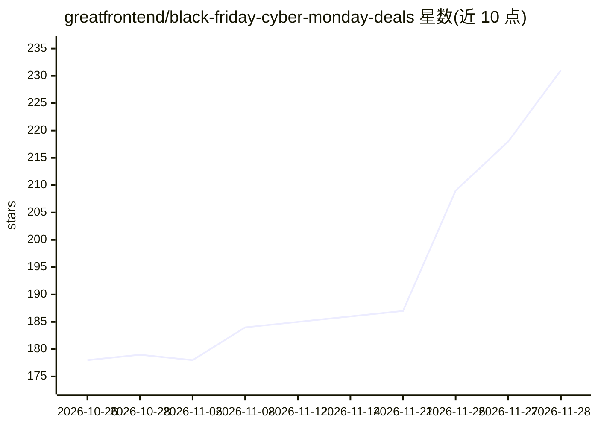

# greatfrontend/black-friday-cyber-monday-deals

⭐ 231 · TypeScript · 推送 2026-11-27 · [GitHub](https://github.com/greatfrontend/black-friday-cyber-monday-deals) · [官网](https://ctrlfriday.com) · 组织维护

**面向开发者与设计师的黑五/网络星期一优惠目录**

Ctrl Friday 维护的黑五与网络星期一促销清单，按技术面试备考、开发者课程、开发工具、开发者 AI、书籍、UI/入门套件、设计工具与课程、效率等约 20 个类别组织；每条记录产品名称、描述、折扣码与折扣详情、有效期。README 介绍其网站支持按产品、关键词或优惠码搜索，按类别过滤与按折扣或名称排序，可在浏览器保存优惠并一键复制优惠码。

## 筛选速览

| 维度 | 判定 | 备注 |
|---|---|---|
| AI 角色 | `ai-knowledge` | 知识聚合/清单类 |
| 许可风险 | `none` | — |
| 部署形态 | `None` |  |
| 模型依赖 | — | README 未给出锁定关系 |
| 硬件要求 | — | 无带数字的原话,不猜 |
| 安装摩擦 | `low` | 无编译、无系统依赖或容器化 |
| 成熟度 | — | 结构信号不足 |

## 能力要点

- 按约 20 个类别组织的黑五/网一优惠条目列表
- 每条含产品描述、折扣码、折扣详情与有效期
- 配套网站支持搜索、过滤、排序与浏览器内保存优惠、一键复制优惠码

## 适用场景

- 黑五期间查找开发者课程与工具的折扣
- 比较不同产品的优惠码与有效期
- 查找面试备考、UI 套件、设计资源类促销

## 场景标签

`精选清单` · 领域:学习与行业

## 证据(README 行号)

> L1: # Ctrl Friday — Black Friday & Cyber Monday Deals 2026
> L5: - Search by product, keyword, or coupon code. Filter by category and sort by discount or name.
> L12: - 🎓 Technical interviews preparation

## 星数曲线

2026-10-26 178 → 2026-11-28 231（+53）

---
*卡片 v1 · prompt 1.4 · 生成 2026-11-28 · 置信度 high · 依据 README sha `945ae4fcf97a` · [字段定义](../../DATASET.md)*
