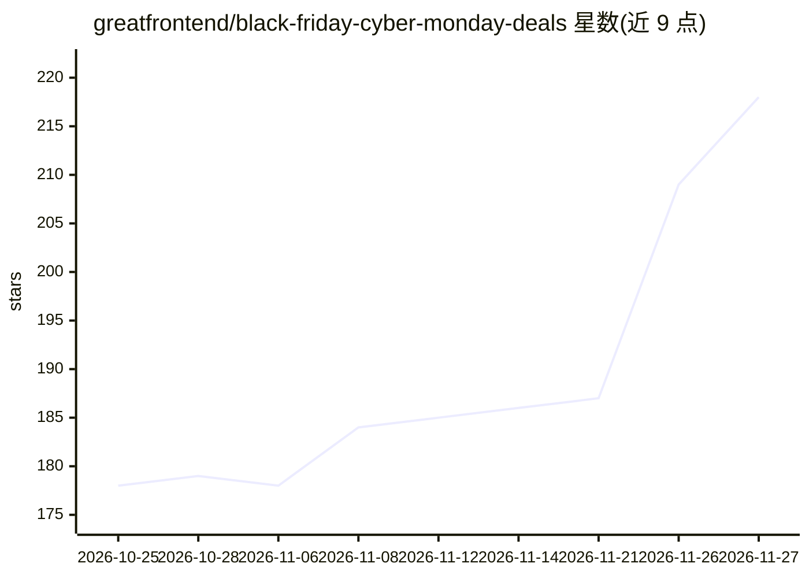

# greatfrontend/black-friday-cyber-monday-deals

⭐ 218 · TypeScript · 推送 2026-11-26 · [GitHub](https://github.com/greatfrontend/black-friday-cyber-monday-deals) · [官网](ctrlfriday.com) · 组织维护

**面向开发者与设计师的黑五折扣清单汇总**

由 GreatFrontEnd 维护的年度 Black Friday / Cyber Monday 折扣汇总页，收录面向软件工程师、开发者与设计师的优惠条目，按技术面试备考、课程、UI 模板、开发者工具、书籍、效率工具、AI 工具、设计资源等类别组织成表格，条目含折扣码、有效期与最近核验日期。接受社区 PR 投稿，声明保留删除或重排低质量产品的权限，页面含联盟链接。纯 Markdown 清单，无安装或运行步骤。

## 筛选速览

| 维度 | 判定 | 备注 |
|---|---|---|
| AI 角色 | `ai-knowledge` | 知识聚合/清单类 |
| 许可风险 | `none` | — |
| 部署形态 | `None` |  |
| 模型依赖 | — | README 未给出锁定关系 |
| 硬件要求 | — | 无带数字的原话,不猜 |
| 安装摩擦 | `low` | 无编译、无系统依赖或容器化 |
| 成熟度 | — | 结构信号不足 |

## 能力要点

- 按 9 个类别组织的折扣条目表格，含折扣码与有效期
- 标注最近核验日期（2026-11-23）
- 开放社区 PR 投稿并声明可自行删除低质量条目
- 含 AI 工具专区（BoltAI、inReels.ai、SharpAPI、GoStudio.ai）

## 适用场景

- 黑五期间查找开发与设计类产品的折扣
- 查询特定课程、模板或工具是否有限时优惠码
- 投稿自己产品的黑五促销信息

## 场景标签

`精选清单` · 领域:学习与行业

## 证据(README 行号)

> L1: # Black Friday & Cyber Monday Deals 2026
> L3: Black Friday and Cyber Monday 2026 deals for software engineers, developers, and designers. Find discounts on techni
> L32: - 🤖 Jump to AI-powered tools

## 星数曲线

2026-10-25 178 → 2026-11-27 218（+40）

---
*卡片 v1 · prompt 1.4 · 生成 2026-11-26 · 置信度 high · 依据 README sha `43eab201b820` · [字段定义](../../DATASET.md)*
