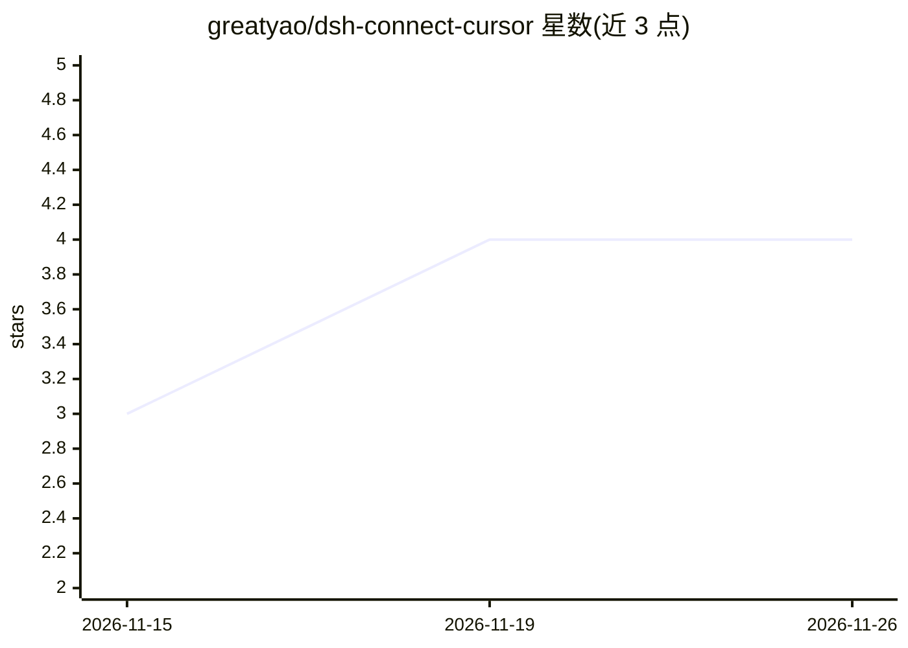

# greatyao/dsh-connect-cursor

⭐ 4 · JavaScript · MIT · 推送 2026-10-24 · [GitHub](https://github.com/greatyao/dsh-connect-cursor) · 个人维护 · 中文 README

**把本机 Cursor 登录的模型接入 DeepSeek Harness 的插件**

一个 dsh 插件，通过逆向 Cursor 的 agent.v1.AgentService/Run 私有协议（ConnectRPC + Protobuf + HTTP/2 双向流），以原生 LlmAdapter 直连方式把 Cursor 桌面应用登录态可调用的模型提供给 DeepSeek Harness（dsh）的模型选择器。凭据按优先级读取环境变量、state.vscdb（需 Node 22.5+ 内置 node:sqlite）、auth.json 或 API key，均为只读。README 声明为非官方、仅供学习研究，且存在协议版本门控、model_id 限制等已知限制，Windows 未实测。

## 筛选速览

| 维度 | 判定 | 备注 |
|---|---|---|
| AI 角色 | `ai-ecosystem` | LLM/agent 周边工具 |
| 许可风险 | `permissive` | MIT |
| 部署形态 | `None` |  |
| 模型依赖 | — | README 未给出锁定关系 |
| 硬件要求 | — | 无带数字的原话,不猜 |
| 安装摩擦 | `low` | 无编译、无系统依赖或容器化 |
| 成熟度 | — | 结构信号不足 |

## 能力要点

- 原生 LlmAdapter 直连 HTTP/2 双向流，不走 loopback 代理
- 四种只读凭据来源按优先级自动选取，无需 OAuth
- 通过 AvailableModels 实时拉取模型目录，dsh 模型选择器出现 cursor 分组
- 附带 46 个单测，支持 macOS/Windows/Linux 平台探测

## 适用场景

- 已订阅 Cursor 的用户在 dsh 里复用其账号可调用的模型
- 为 Cursor 私有协议的学习研究提供参考实现
- 在 DeepSeek Harness 中统一管理多个模型来源

## 场景标签

`模型网关` · 领域:Agent 开发

## 证据(README 行号)

> L3: 把本机已登录的 Cursor 桌面应用的模型接入 DeepSeek Harness（`dsh`），在 dsh 的模型选择器里直接使用 Cursor 账号能调用的模型。
> L10: - 通过 HTTP/2 双向流调用 `agent.v1.AgentService/Run`，用原生 `LlmAdapter` 把 Cursor 的流式增量翻成 dsh 的 `StreamChunk`（不走 loopback 代理）

## 星数曲线

2026-11-15 3 → 2026-11-26 4（+1）

---
*卡片 v1 · prompt 1.4 · 生成 2026-11-21 · 置信度 high · 依据 README sha `f0ea55b373d3` · [字段定义](../../DATASET.md)*
