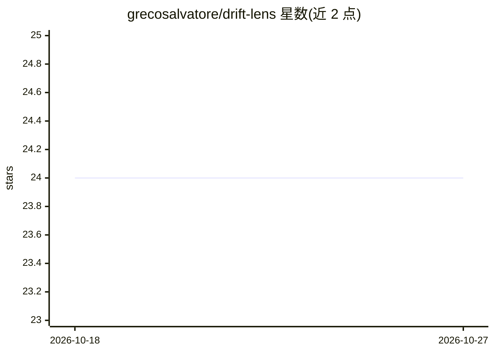

# grecosalvatore/drift-lens

⭐ 24 · Jupyter Notebook · MIT · 推送 2026-02-11 · [GitHub](https://github.com/grecosalvatore/drift-lens) · [官网](https://driftlens.readthedocs.io/) · 组织维护

**深度学习分类器的实时无监督概念漂移检测框架**

面向处理非结构化数据（CV/NLP/语音）的深度学习分类器，DriftLens 提供无监督、实时的概念漂移检测与表征：离线阶段从基线数据估计嵌入分布参考（均值与协方差的多元正态分布）并设定阈值；在线阶段按固定窗口计算新数据与参考分布的 Fréchet 距离，超过阈值即判定漂移。以 Python 包（PyPI）形式提供，方法论发表于 IEEE TKDE，作者来自都灵理工大学。

## 筛选速览

| 维度 | 判定 | 备注 |
|---|---|---|
| AI 角色 | `ai-ecosystem` | LLM/agent 周边工具 |
| 许可风险 | `permissive` | MIT |
| 部署形态 | `library` | 以包/库形式分发 |
| 模型依赖 | — | README 未给出锁定关系 |
| 硬件要求 | — | 无带数字的原话,不猜 |
| 安装摩擦 | `low` | 无编译、无系统依赖或容器化 |
| 成熟度 | — | 结构信号不足 |

## 能力要点

- 无监督、实时概念漂移检测与表征
- 基于深度学习嵌入分布与 Fréchet 距离（离线基线+在线窗口判定）
- 适用 CV/NLP/语音等非结构化数据分类器
- 提供实验复现脚本（experiments 文件夹）

## 适用场景

- 监控生产环境中深度学习模型的数据/概念漂移
- 在无需标注数据的情况下判定模型输入分布变化
- 复现论文中的漂移检测实验评估

## 场景标签

`MLOps` · 领域:训练与推理

## 证据(README 行号)

> L13: *DriftLens* is an **unsupervised** framework for real-time *concept drift* **detection** and **characterization**.
> L14: It is designed for deep learning classifiers handling unstructured data, and leverages distribution distances in de

## 星数曲线

2026-10-18 24 → 2026-10-27 24（+0）

---
*卡片 v1 · prompt 1.4 · 生成 2026-10-27 · 置信度 high · 依据 README sha `f2a83d943bc4` · [字段定义](../../DATASET.md)*
