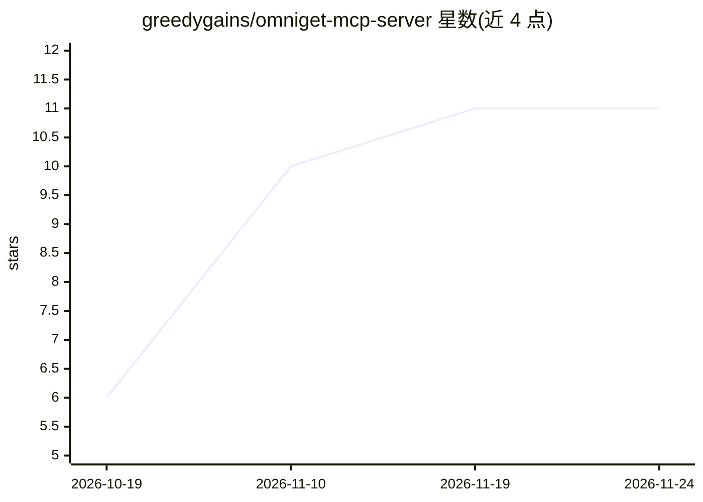

# greedygains/omniget-mcp-server

⭐ 11 · Rust · GPL-3.0 · 推送 2026-09-22 · [GitHub](https://github.com/greedygains/omniget-mcp-server) · 组织维护

**给 AI Agent 提供社交/网页/PDF 内容提取的 MCP 服务器**

以原生 Rust 实现的无头 MCP 服务器与 REST API，为 Claude Desktop、Cursor、ChatGPT 等 AI 客户端提供 7 个提取工具：Facebook/Instagram 帖子与媒体、X 推文与线程展开、网页转 Markdown、PDF 文本提取、以及基于 yt-dlp 的 1,800+ 站点媒体元数据。不依赖浏览器自动化，通过异步 Rust HTTP 引擎与内嵌状态解码器运行；同时提供 MCP over SSE、Streamable HTTP MCP 与 OpenAPI 3.1 REST 三种协议接口，并带 Bearer token 时序安全认证。

## 筛选速览

| 维度 | 判定 | 备注 |
|---|---|---|
| AI 角色 | `ai-ecosystem` | LLM/agent 周边工具 |
| 许可风险 | `viral` | GPL-3.0 |
| 部署形态 | `self-host` | docker 或自建部署 |
| 模型依赖 | — | README 未给出锁定关系 |
| 硬件要求 | — | 无带数字的原话,不猜 |
| 安装摩擦 | `low` | 无编译、无系统依赖或容器化 |
| 成熟度 | — | 结构信号不足 |

## 能力要点

- Facebook/Instagram 原生 Rust 提取引擎，解码 Relay/GraphQL 与 Bloks 数据结构
- X 线程展开与网页转 token 高效 Markdown
- yt-dlp 集成支持 1,800+ 媒体站点元数据提取
- MCP SSE、Streamable HTTP 与 OpenAPI 3.1 REST 三协议并存

## 适用场景

- 让 Claude Desktop 或 Cursor 直接读取社交帖子和网页内容
- 为 LLM 工作流批量转换文章为 Markdown
- 通过 REST API 部署自己的内容提取服务

## 场景标签

`网页抓取` `文档解析` · 领域:效率与自动化

## 证据(README 行号)

> L14: **OmniGet MCP Server** is an ultra-fast, headless Model Context Protocol (MCP) server and REST API built in **Nativ
> L41: - **⚡ Dual Protocol Support**:
> L48: When connected to an MCP client (Claude Desktop, Cursor, etc.), the server exposes 7 powerful extraction tools:

## 星数曲线

2026-10-19 6 → 2026-11-24 11（+5）

---
*卡片 v1 · prompt 1.4 · 生成 2026-11-19 · 置信度 high · 依据 README sha `8f228bd33b3d` · [字段定义](../../DATASET.md)*
