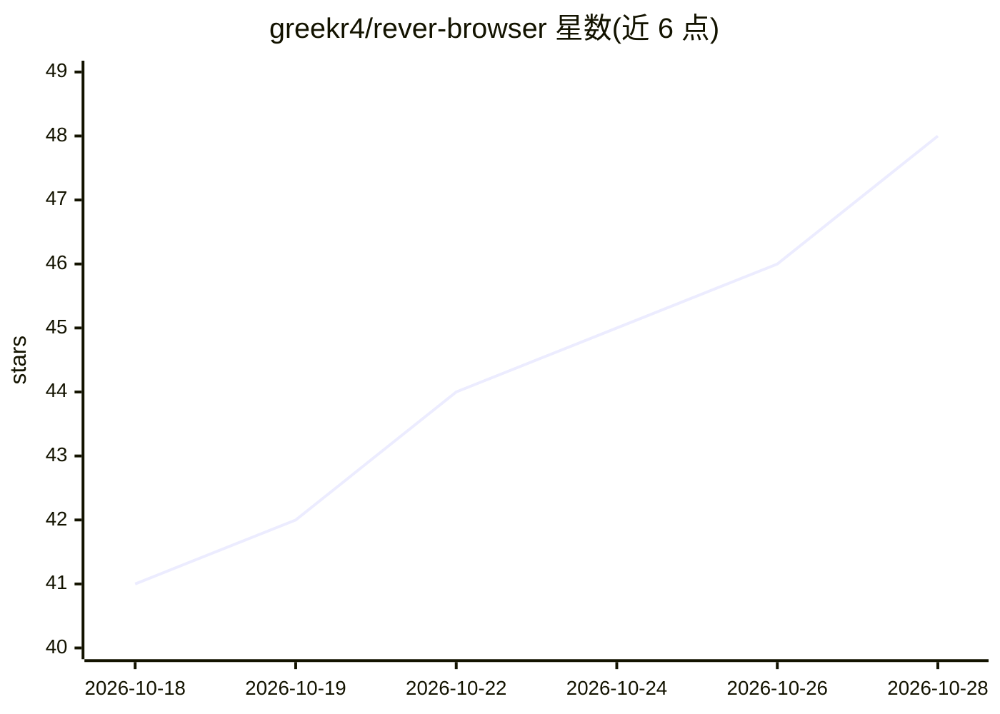

# greekr4/rever-browser

⭐ 48 · TypeScript · MIT · 推送 2026-10-28 · [GitHub](https://github.com/greekr4/rever-browser) · [官网](https://github.com/greekr4/rever-browser/releases/latest) · 个人维护

**面向 API 逆向工程的 agent 驱动桌面工作台**

Electron 桌面应用，将真实 Chromium 标签页与 ACP 编码 agent（默认 Claude Code）配对：内嵌 webview 浏览目标站点，经 Chrome DevTools Protocol 记录全部网络请求，agent 通过进程内 MCP 工具服务器（44 个域、156 个工具）读取流量、分析与反混淆 JS/WASM、驱动标签页。工作流为捕获→分析→重放→验证→自动化五阶段，可把有效序列固化为无 LLM 参与的确定性宏、CLI 命令或 Python 客户端。支持 4 家提供方的 5 种 agent。提供 macOS/Windows 安装包，构建依赖 Bun；限定授权安全研究用途。

## 筛选速览

| 维度 | 判定 | 备注 |
|---|---|---|
| AI 角色 | `ai-ecosystem` | LLM/agent 周边工具 |
| 许可风险 | `permissive` | MIT |
| 部署形态 | `desktop` | 安装包/桌面程序 |
| 模型依赖 | locked-api |  |
| 硬件要求 | — | 无带数字的原话,不猜 |
| 安装摩擦 | `low` | 无编译、无系统依赖或容器化 |
| 成熟度 | — | 结构信号不足 |

## 能力要点

- 156 个 MCP 工具、44 个域，覆盖流量捕获、WASM 反编译、加密签名追踪、模糊测试等
- 五阶段逆向循环：捕获→分析→重放→验证→自动化
- 宏重放与 CLI/Python 客户端导出，运行时无 LLM 参与
- 5 种 agent 可选（Claude Code、Codex 本地 ACP，Claude/OpenAI/Grok API 直连）

## 适用场景

- 分析目标站点的请求签名与 API 调用方式
- 在授权范围内对 API 做重放、篡改与安全探测
- 把逆向出的调用流程固化为可复用的脚本或客户端

## 场景标签

`浏览器自动化` `网页抓取` `网络安全` · 领域:效率与自动化

## 证据(README 行号)

> L18: `rever-browser` is an Electron desktop app that pairs a **real Chromium tab** with an **ACP coding agent** (Claude 
> L156: **Agent loop:** `ChatPanel → ACPChatTransport → preload IPC → main/acp-session.ts → ACP agent child process → MCP 

## 星数曲线

2026-10-18 41 → 2026-10-28 48（+7）

---
*卡片 v1 · prompt 1.4 · 生成 2026-10-25 · 置信度 mid · 依据 README sha `de4f6fd0138e` · [字段定义](../../DATASET.md)*
