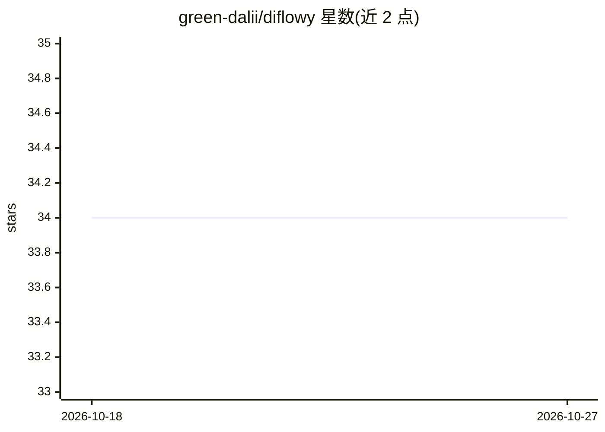

# green-dalii/diflowy

⭐ 34 · Astro · MIT · 推送 2026-08-12 · [GitHub](https://github.com/green-dalii/diflowy) · [官网](https://diflowy.greenerai.top) · 个人维护 · 中文 README

**Dify 工作流的社区平台：探索、分享、下载与托管**

面向 Dify 用户的工作流社区网站：用户可分享、浏览、下载 Dify Workflow 文件，并在平台内托管工作流、与协作者在 Workspace 同步进度。提供工作流多版本管理、私有托管模式（数据库级 AES-GCM 加密）、节点图实时预览，以及通过 URL 一键导入 Dify.AI 的快捷通道。技术栈基于 Astro、TailwindCSS、ReactFlow，部署使用 Cloudflare Pages 与 D1 数据库。项目以 MIT 许可发布，路线图中的 AI 工作流摘要与搜索功能尚未实现。

## 筛选速览

| 维度 | 判定 | 备注 |
|---|---|---|
| AI 角色 | `ai-knowledge` | 知识聚合/清单类 |
| 许可风险 | `permissive` | MIT |
| 部署形态 | `None` |  |
| 模型依赖 | — | README 未给出锁定关系 |
| 硬件要求 | — | 无带数字的原话,不猜 |
| 安装摩擦 | `low` | 无编译、无系统依赖或容器化 |
| 成熟度 | — | 结构信号不足 |

## 能力要点

- 工作流的分享、下载与社区托管
- 私有托管模式：数据库级 AES-GCM 加密
- 多版本管理与 Workspace 协作
- 通过 URL 一键导入 Dify.AI

## 适用场景

- 查找现成的 Dify 工作流用于自己的项目
- 托管并管理自己的工作流多版本文件
- 与协作者共享工作流并同步进度

## 场景标签

`精选清单` · 领域:学习与行业

## 证据(README 行号)

> L5: > Explore, Share, Download, Host Dify Workflows in Diflowy.
> L13: Diflowy is a vibrant community platform for Dify workflows where you can:
> L27: - 👥 **User-driven**: A collaborative Workflow knowledge base that benefits everyone.

## 星数曲线

2026-10-18 34 → 2026-10-27 34（+0）

---
*卡片 v1 · prompt 1.4 · 生成 2026-10-25 · 置信度 high · 依据 README sha `0805ad6c5298` · [字段定义](../../DATASET.md)*
