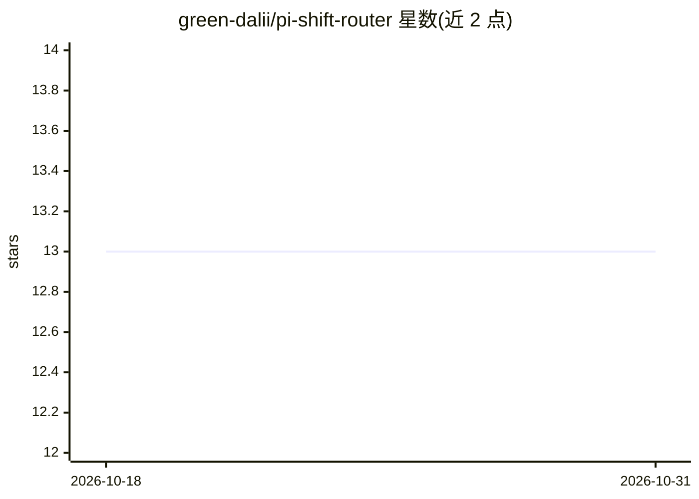

# green-dalii/pi-shift-router

⭐ 13 · TypeScript · MIT · 推送 2026-10-24 · [GitHub](https://github.com/green-dalii/pi-shift-router) · [官网](https://shiftrouter.greenerai.top) · 个人维护 · 中文 README

**Pi 编码代理的逐轮模型路由扩展：由 judge 选便宜或强模型**

以 pi-coding-agent 扩展形式运行的逐轮模型路由器：每条消息先由 judge（复用 fast 层模型、专用 LLM 或决策模型）分类为 fast/smart，被选中的层执行整轮对话。支持同层多模型故障转移（指数退避冷却）、复杂任务的任务级编排（需 pi-subagents）、升级即时/降级需连续两轮 fast 的防抖机制，以及以概率而非文本作答的决策模型 judge（Beta，默认关闭）。单个配置文件，未选模型前不做任何事。

## 筛选速览

| 维度 | 判定 | 备注 |
|---|---|---|
| AI 角色 | `ai-ecosystem` | LLM/agent 周边工具 |
| 许可风险 | `permissive` | MIT |
| 部署形态 | `None` |  |
| 模型依赖 | — | README 未给出锁定关系 |
| 硬件要求 | — | 无带数字的原话,不猜 |
| 安装摩擦 | `low` | 无编译、无系统依赖或容器化 |
| 成熟度 | `idea` | |

## 能力要点

- 逐轮 judge 分类 fast/smart，置信度阈值 θ≈0.33 可调（sport/eco 模式）
- 同层多模型 failover 与指数退避冷却（429/5xx/配额耗尽）
- 三种 judge 模式：复用 fast 层 / 专用 LLM / 决策模型（返回概率，Beta）
- 复杂任务默认启用任务级编排：smart 层规划并委派 fast 子代理（需 pi-subagents）

## 适用场景

- 编码代理中按任务难度自动切换便宜与旗舰模型以控制成本
- 单一模型 429/限流时自动切换到同层备用模型
- 复杂架构任务自动升级到强模型并委派子代理执行

## 场景标签

`模型网关` · 领域:Agent 开发

## 证据(README 行号)

> L29: This extension removes the bet. A small judge reads each message and picks a tier; that tier
> L32: pi-coding-agent extension — no separate server, no

## 星数曲线

2026-10-18 13 → 2026-10-31 13（+0）

---
*卡片 v1 · prompt 1.4 · 生成 2026-10-31 · 置信度 high · 依据 README sha `1e637ba3345b` · [字段定义](../../DATASET.md)*
