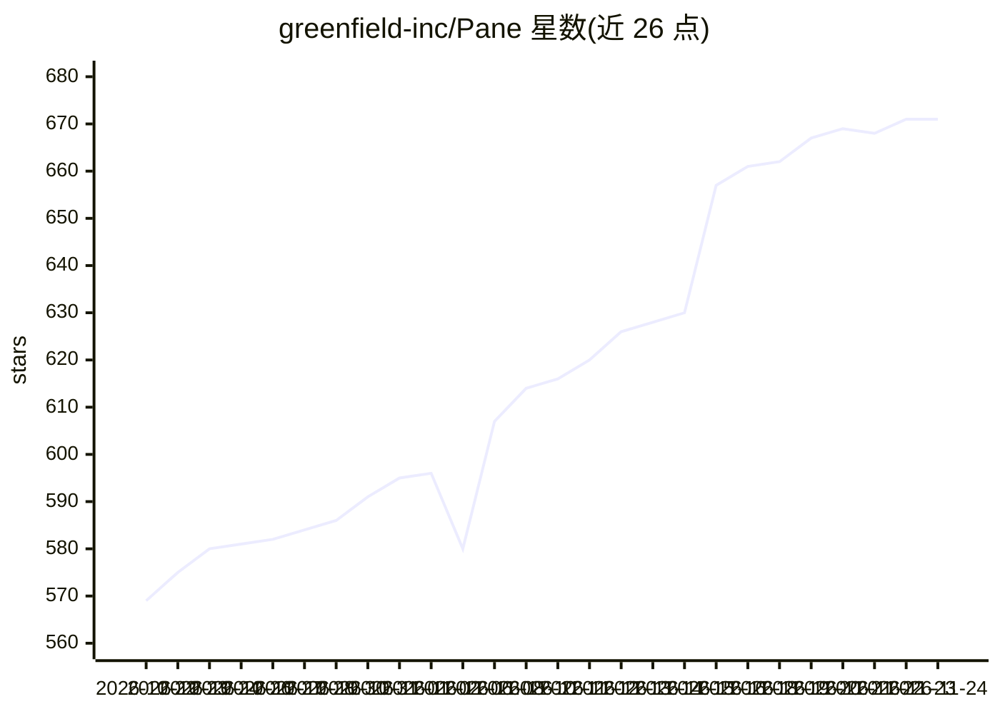

# greenfield-inc/Pane

⭐ 677 · TypeScript · NOASSERTION · 推送 2026-11-23 · [GitHub](https://github.com/greenfield-inc/Pane) · [官网](https://runpane.com/) · 组织维护

**给开发者的多 CLI 编码 agent 并行管理终端工具**

以终端为核心的 AI 编码 agent 管理器：不替换既有 CLI agent，任何能在终端运行的工具（Claude Code、Codex、Cursor Agent、Aider、Goose 等）无需插件或 SDK 即可直接在 Pane 中运行。内置 git worktree 自动创建/清理/rebase、会话编排、审批通知、密钥管理、定时任务、机器健康监控等功能，支持本地或自托管 Remote Pane，从桌面或手机浏览器控制远程机器上的 agent。AGPL-3.0 许可，提供 Mac/Linux/Windows 安装包与 npm/pnpm/pipx 安装方式。

## 筛选速览

| 维度 | 判定 | 备注 |
|---|---|---|
| AI 角色 | `ai-ecosystem` | LLM/agent 周边工具 |
| 许可风险 | `none` | NOASSERTION |
| 部署形态 | `desktop` | 安装包/桌面程序 |
| 模型依赖 | — | README 未给出锁定关系 |
| 硬件要求 | — | 无带数字的原话,不猜 |
| 安装摩擦 | `low` | 无编译、无系统依赖或容器化 |
| 成熟度 | — | 结构信号不足 |

## 能力要点

- 零集成的 agent 管理：终端内可运行的 CLI agent 均可直接使用
- git worktree 自动创建、清理与 rebase，隐去命令细节
- 审批队列（notify MCP 工具）与跨机器密钥同步
- 自托管 Remote Pane，桌面/手机浏览器均可控制

## 适用场景

- 在同一界面并行运行多个编码 agent 并跟踪各自分支
- 在手机上审批远程机器上等待确认的 agent 操作
- 用定时任务按 cron 周期运行夜间巡检类 agent 任务

## 场景标签

`编码 Agent` · 领域:编码与开发

## 证据(README 行号)

> L3:  Run any coding agent, on any OS, from desktop or phone.
> L71: Pane manages AI coding agents without replacing them. If it runs in a terminal, it runs in Pane — instantly, with z
> L92: |**Remote Pane**|Run panes, worktrees, terminals, files, git state, and approval prompts on a self-hosted remote ma

## 星数曲线

2026-10-22 569 → 2026-11-24 671（+102）

---
*卡片 v1 · prompt 1.4 · 生成 2026-11-24 · 置信度 mid · 依据 README sha `9a9d0af0518d` · [字段定义](../../DATASET.md)*
