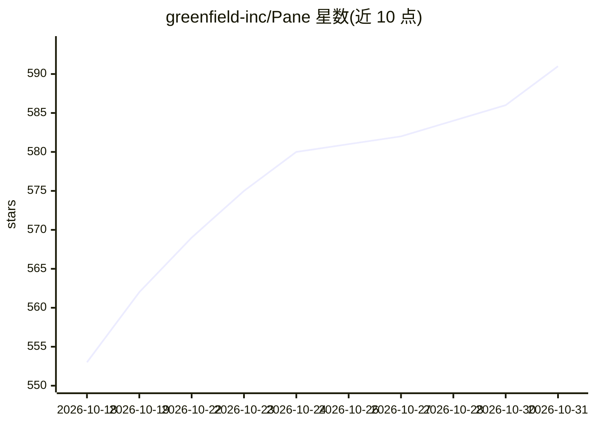

# greenfield-inc/Pane

⭐ 591 · TypeScript · NOASSERTION · 推送 2026-10-30 · [GitHub](https://github.com/greenfield-inc/Pane) · [官网](https://runpane.com/) · 组织维护

**跨平台终端优先的 AI 编码 agent 管理器**

Pixel-art 风格的终端工作台，用于并行运行和管理多个 CLI 编码 agent（Claude Code、Codex、Cursor Agent、Aider、Goose 等），agent 无关、无需插件或 SDK。为每个会话自动创建/清理 git worktree，提供 Pane Chat 全局编排终端、Remote Pane 自托管远程管理（桌面/手机浏览器控制）、跨机 Workspaces 与任务 Handoff、@mention 终端上下文引用、按 pane 的 CPU/内存监控、agent 状态指示等。AGPL-3.0 许可，macOS/Windows/Linux 提供安装包，另支持 npx/pnpm/pipx 安装。

## 筛选速览

| 维度 | 判定 | 备注 |
|---|---|---|
| AI 角色 | `ai-ecosystem` | LLM/agent 周边工具 |
| 许可风险 | `none` | NOASSERTION |
| 部署形态 | `desktop` | 安装包/桌面程序 |
| 模型依赖 | — | README 未给出锁定关系 |
| 硬件要求 | — | 无带数字的原话,不猜 |
| 安装摩擦 | `low` | 无编译、无系统依赖或容器化 |
| 成熟度 | — | 结构信号不足 |

## 能力要点

- 任何 CLI agent 零集成即可运行，会话自动创建与清理 git worktree
- Remote Pane 自托管远程管理，桌面或手机浏览器（runpane.com/app）控制远程机器上的 agent
- Pane Workspaces 基于 Tailscale 的跨机文件/命令访问与任务 Handoff
- Agent-Operable CLI：runpane agent-context/repos/panes 命令供 agent 调用，Claude Code/Codex/Cursor 同样作为 MCP 工具暴露

## 适用场景

- 在同一窗口并行运行多个编码 agent 并跟踪各自状态与分支
- 在手机上通过自托管 Remote Pane 监控家中的 agent 任务
- 用 git worktree 隔离多个 agent 的并行改动并自动清理
- 让 agent 通过 CLI/MCP 命令自行注册仓库、开 Pane 并跨机执行任务

## 场景标签

 · 领域:开发者工具/agent 编排

## 证据(README 行号)

> L71: Pane manages AI coding agents without replacing them. If it runs in a terminal, it runs in Pane — instantly, with z
> L94: |**Agent-Operable CLI**|Pane ships with `runpane agent-context`, `runpane repos add`, and `runpane panes create`, s

## 星数曲线

2026-10-18 553 → 2026-10-31 591（+38）

---
*卡片 v1 · prompt 1.4 · 生成 2026-10-21 · 置信度 high · 依据 README sha `ae9ce1ba7c98` · [字段定义](../../DATASET.md)*
