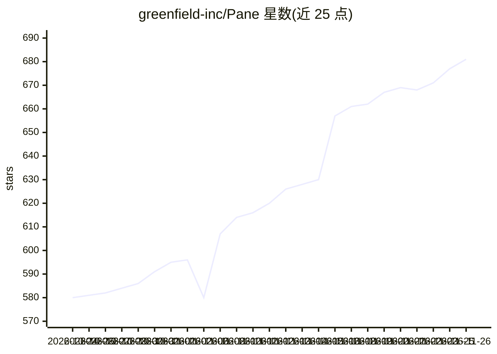

# greenfield-inc/Pane

⭐ 681 · TypeScript · NOASSERTION · 推送 2026-11-25 · [GitHub](https://github.com/greenfield-inc/Pane) · [官网](https://runpane.com/) · 组织维护

**终端优先的多 AI coding agent 管理器，桌面/手机均可控制**

一个 agent-agnostic 的终端管理器：运行任何 CLI 编码代理（Claude Code、Codex、Cursor Agent、Aider、Goose 等），不替代代理本身、无需插件或 SDK 集成。核心机制包括自动管理 git worktree 实现并行隔离、Pane Chat 全局编排终端、Agent-Operable CLI（以 MCP 工具形式暴露命令给代理）、审批队列（notify MCP 工具）、密钥管理、定时任务 Loops、Profile 工作流定义等。跨 macOS/Windows/Linux，可自托管 Remote Pane 从桌面或手机浏览器控制远程机器。AGPL-3.0 许可。

## 筛选速览

| 维度 | 判定 | 备注 |
|---|---|---|
| AI 角色 | `ai-ecosystem` | LLM/agent 周边工具 |
| 许可风险 | `none` | NOASSERTION |
| 部署形态 | `desktop` | 安装包/桌面程序 |
| 模型依赖 | — | README 未给出锁定关系 |
| 硬件要求 | — | 无带数字的原话,不猜 |
| 安装摩擦 | `low` | 无编译、无系统依赖或容器化 |
| 成熟度 | — | 结构信号不足 |

## 能力要点

- 运行任意终端 CLI 编码代理，零集成、无插件/SDK 要求
- 自动创建与清理 git worktree 支持并行代理会话隔离
- Agent-Operable CLI 将命令以 MCP 工具暴露给 Claude Code/Codex/Cursor
- 自托管 Remote Pane，可从手机或另一台机器远程控制

## 适用场景

- 同时并行运行多个编码代理处理不同任务分支
- 在手机上远程查看和批准代理的执行请求
- 按 cron 定时在全新 worktree 中运行夜间巡检任务
- 用 Profile 文件定义 plan→build→review→merge 的固定代理工作流

## 场景标签

`编码 Agent` · 领域:编码与开发

## 证据(README 行号)

> L3:  Run any coding agent, on any OS, from desktop or phone.
> L71: Pane manages AI coding agents without replacing them. If it runs in a terminal, it runs in Pane — instantly, with z
> L92: |**Remote Pane**|Run panes, worktrees, terminals, files, git state, and approval prompts on a self-hosted remote ma

## 星数曲线

2026-10-24 580 → 2026-11-26 681（+101）

---
*卡片 v1 · prompt 1.4 · 生成 2026-11-25 · 置信度 mid · 依据 README sha `f58e280a0ef1` · [字段定义](../../DATASET.md)*
