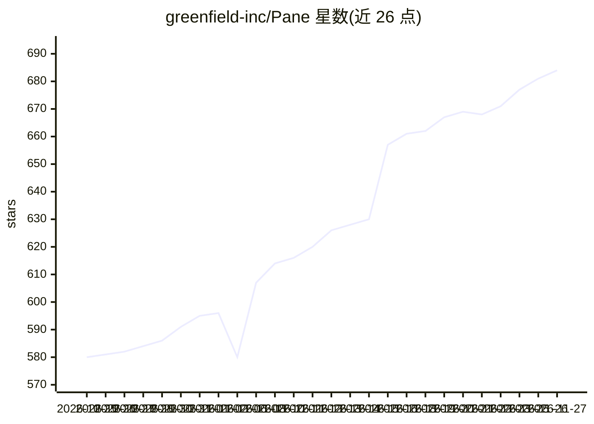

# greenfield-inc/Pane

⭐ 684 · TypeScript · NOASSERTION · 推送 2026-11-26 · [GitHub](https://github.com/greenfield-inc/Pane) · [官网](https://runpane.com/) · 组织维护

**管理多个 CLI 编码 agent 的终端优先桌面工具**

终端优先的开源 agent 管理器：在统一界面并行运行多个 CLI 编码 agent（声明支持任意能在终端运行的 agent，零集成接入），自动管理 git worktree 的创建/清理/rebase，提供 Pane Chat 编排终端、Remote Pane 自托管远程控制、审批队列、secrets 管理、定时任务 Loops、状态指示与内置浏览器预览。提供 macOS/Windows/Linux 安装包及 npx/pnpm/pipx 安装方式，AGPL-3.0 许可。

## 筛选速览

| 维度 | 判定 | 备注 |
|---|---|---|
| AI 角色 | `ai-ecosystem` | LLM/agent 周边工具 |
| 许可风险 | `none` | NOASSERTION |
| 部署形态 | `desktop` | 安装包/桌面程序 |
| 模型依赖 | — | README 未给出锁定关系 |
| 硬件要求 | — | 无带数字的原话,不猜 |
| 安装摩擦 | `low` | 无编译、无系统依赖或容器化 |
| 成熟度 | — | 结构信号不足 |

## 能力要点

- 任意终端可运行的 CLI agent 即可接入，声明无插件/SDK 要求
- 自动 git worktree 管理：创建会话即建 worktree，删除即清理
- Remote Pane 自托管：从桌面或手机浏览器控制远程机器上的 agent
- 审批队列、secrets 掩码卡片与跨机同步

## 适用场景

- 在多个 worktree 中并行运行多个编码 agent
- 从手机审批远程机器上 agent 的操作请求
- 用 cron 定时跑夜间 bug 巡检任务

## 场景标签

`编码 Agent` · 领域:编码与开发

## 证据(README 行号)

> L69: Not an IDE. Not a terminal emulator. **Vim for agent management.**
> L71: Pane manages AI coding agents without replacing them. If it runs in a terminal, it runs in Pane — instantly, with z

## 星数曲线

2026-10-25 580 → 2026-11-27 684（+104）

---
*卡片 v1 · prompt 1.4 · 生成 2026-11-27 · 置信度 high · 依据 README sha `5d32e99a1d3f` · [字段定义](../../DATASET.md)*
