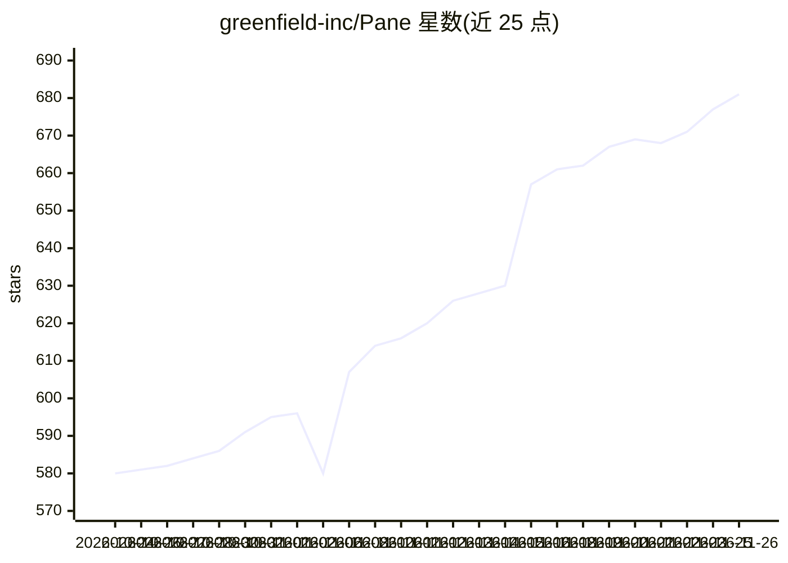

# greenfield-inc/Pane

⭐ 681 · TypeScript · NOASSERTION · 推送 2026-11-25 · [GitHub](https://github.com/greenfield-inc/Pane) · [官网](https://runpane.com/) · 组织维护

**多 AI 编码 agent 的终端优先管理器：并行运行、审批与交接**

终端优先的开源 AI agent 管理器，跨 macOS/Windows/Linux 运行任意 CLI 编码 agent（Claude Code、Codex、Cursor Agent、Aider 等），零集成接入。核心机制包括自动 git worktree 隔离、全局编排终端 Pane Chat、自托管 Remote Pane（桌面/手机远程控制）、审批队列、密钥卡管理、cron 定时 Loops、机器健康监控与 Agent-Operable CLI（MCP 工具形式）。提供安装脚本、安装包与 npx/pnpm/pipx 等多种安装方式，AGPL-3.0 许可。

## 筛选速览

| 维度 | 判定 | 备注 |
|---|---|---|
| AI 角色 | `ai-ecosystem` | LLM/agent 周边工具 |
| 许可风险 | `none` | NOASSERTION |
| 部署形态 | `desktop` | 安装包/桌面程序 |
| 模型依赖 | — | README 未给出锁定关系 |
| 硬件要求 | — | 无带数字的原话,不猜 |
| 安装摩擦 | `low` | 无编译、无系统依赖或容器化 |
| 成熟度 | — | 结构信号不足 |

## 能力要点

- 管理任意终端 CLI agent，无需插件或 SDK
- 自动创建/清理 git worktree 实现并行隔离
- 自托管 Remote Pane，从桌面或手机控制远程机器上的 agent
- 审批队列与 secrets 卡片，agent 通过 notify MCP 工具向用户提问

## 适用场景

- 在同一台机器上并行运行多个编码 agent 并跟踪各自分支
- 通过手机远程查看和审批家里/云服务器上运行的 agent
- 用 cron 定时任务每晚跑 bug 扫描等重复性 agent 作业

## 场景标签

`编码 Agent` · 领域:编码与开发

## 证据(README 行号)

> L71: Pane manages AI coding agents without replacing them. If it runs in a terminal, it runs in Pane — instantly, with z
> L92: |**Remote Pane**|Run panes, worktrees, terminals, files, git state, and approval prompts on a self-hosted remote ma
> L94: |**Agent-Operable CLI**|Pane ships with `runpane agent-context`, `runpane repos add`, and `runpane panes create`, s

## 星数曲线

2026-10-24 580 → 2026-11-26 681（+101）

---
*卡片 v1 · prompt 1.4 · 生成 2026-11-26 · 置信度 high · 依据 README sha `9a4e23cf9dac` · [字段定义](../../DATASET.md)*
