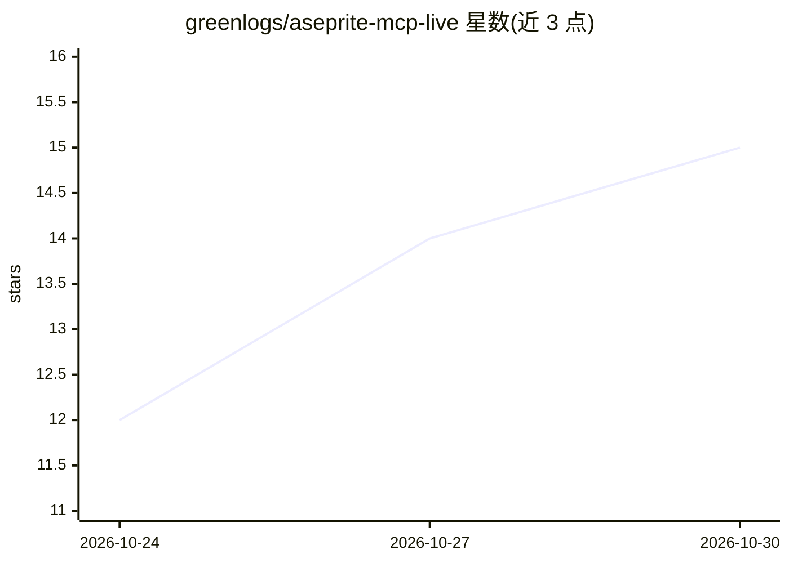

# greenlogs/aseprite-mcp-live

⭐ 15 · Python · MIT · 推送 2026-10-23 · [GitHub](https://github.com/greenlogs/aseprite-mcp-live) · 个人维护 · 中文 README

**连接 AI 与 Aseprite 的 MCP 服务，实现像素画实时协作**

通过 Model Context Protocol 将支持 MCP 的客户端（Codex、ClaudeCode 等）与 Aseprite 连接：Python stdio MCP 服务加 Lua 扩展经本机 WebSocket 通信，可读取和编辑打开文档（含未保存画布）、以 PNG 返回预览、撤销重做，可选启用基础动画（加帧/删帧/标签），另保留 116 个 CLI 磁盘文件批处理工具。实时编辑限普通 RGB 图层，不自动保存，仅监听本机回环地址。需 Python 3.13+ 与 uv，经 PyPI/uvx 或源码构建安装，配套 .aseprite-extension 扩展。

## 筛选速览

| 维度 | 判定 | 备注 |
|---|---|---|
| AI 角色 | `ai-ecosystem` | LLM/agent 周边工具 |
| 许可风险 | `permissive` | MIT |
| 部署形态 | `desktop` | 安装包/桌面程序 |
| 模型依赖 | — | README 未给出锁定关系 |
| 硬件要求 | — | 无带数字的原话,不猜 |
| 安装摩擦 | `low` | 无编译、无系统依赖或容器化 |
| 成熟度 | — | 结构信号不足 |

## 能力要点

- 实时读取和编辑打开文档，包括未保存画布
- 预览以 PNG 图片返回给支持图片内容的 MCP 客户端
- 撤销重做沿用 Aseprite 原生历史，一次编辑批次对应一次撤销
- 可选基础动画与 116 个 CLI 磁盘文件批处理工具

## 适用场景

- 让 AI agent 在我打开的 Aseprite 画布上协作绘制像素画
- 通过对话让 AI 批量绘制像素、矩形并即时预览效果
- AI 批处理磁盘上的 Aseprite 文件

## 场景标签

`图像生成` · 领域:内容生成

## 证据(README 行号)

> L13: Aseprite MCP 将支持 MCP 的客户端如`Codex`，`CluadeCode`，`DeepseekHarness`等Agent与 Aseprite 连接起来，支持读取和编辑未保存画布、图片预览、撤销重做及可选基础动画
> L144: Python MCP 服务通过 stdio 与客户端通信；Lua 扩展通过本机 WebSocket 连接服务，编辑 Aseprite 中的内存文档。实时编辑绑定明确的文档与修订，切换活动窗口不会改变操作目标。

## 星数曲线

2026-10-24 12 → 2026-10-30 15（+3）

---
*卡片 v1 · prompt 1.4 · 生成 2026-10-30 · 置信度 high · 依据 README sha `61a417d37dc3` · [字段定义](../../DATASET.md)*
