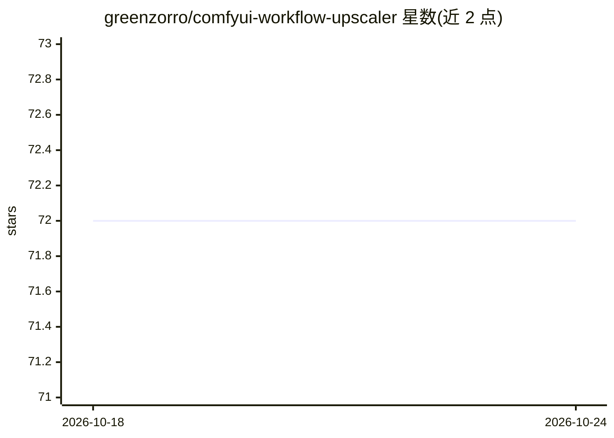

# greenzorro/comfyui-workflow-upscaler

⭐ 72 · MIT · 推送 2026-03-20 · [GitHub](https://github.com/greenzorro/comfyui-workflow-upscaler) · 个人维护 · 中文 README

**ComfyUI 图像放大工作流合集（4 种模式）**

面向 ComfyUI 用户的 upscaling 工作流仓库，提供 Sharpening（仅放大模型、无扩散模型）、Creative（SDXL 加细节，构图可能变化）、Ultra sharp（Flux dev）、Mad mode（SDXL+Flux 串联）四条工作流，各自标注清晰度/创造性/成本星级。使用需自装 5 个自定义节点并下载 Flux dev、DreamShaperXL Lightning、ControlNet、放大模型等权重；可在本地或 Kaggle/Colab notebook 运行。作者自述为 clarity-upscaler 的简化替代。

## 筛选速览

| 维度 | 判定 | 备注 |
|---|---|---|
| AI 角色 | `ai-knowledge` | 知识聚合/清单类 |
| 许可风险 | `permissive` | MIT |
| 部署形态 | `None` |  |
| 模型依赖 | — | README 未给出锁定关系 |
| 硬件要求 | — | 无带数字的原话,不猜 |
| 安装摩擦 | `low` | 无编译、无系统依赖或容器化 |
| 成熟度 | — | 结构信号不足 |

## 能力要点

- 4 条不同清晰度/创造性取向的放大工作流
- 列出所需 5 个自定义节点与全部模型权重的下载目录
- 提供 Kaggle 免费与 Colab 付费 GPU 的运行 notebook

## 适用场景

- 在 ComfyUI 中提升图像分辨率并按需补充细节
- 对比不同放大策略（纯放大 vs SDXL/Flux 生成式放大）
- 在云端 GPU 上免配置运行放大工作流

## 场景标签

`图像视频处理` · 领域:感知与多模态

## 证据(README 行号)

> L5: ComfyUI workflows for upscaling.
> L25: Add details to an image to boost its resolution. Only one upscaler model is used. No diffusion model.
> L35: Add more details with AI imagination with SDXL. Elements in the image may vary.
> L47: Significantly boost an image by resolution with Flux dev. Fails on extremely low-res images (looks pixelated).

## 星数曲线

2026-10-18 72 → 2026-10-24 72（+0）

---
*卡片 v1 · prompt 1.4 · 生成 2026-10-24 · 置信度 high · 依据 README sha `8a1ff4ab184a` · [字段定义](../../DATASET.md)*
