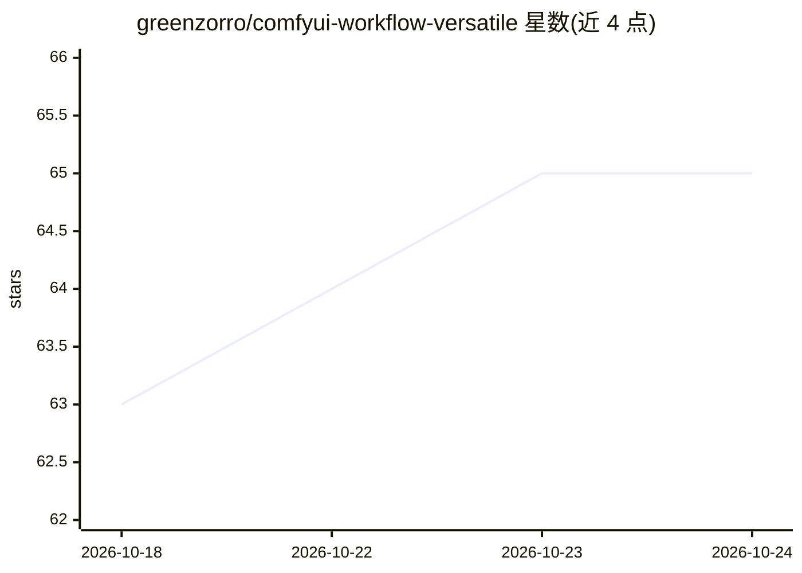

# greenzorro/comfyui-workflow-versatile

⭐ 65 · MIT · 推送 2026-03-20 · [GitHub](https://github.com/greenzorro/comfyui-workflow-versatile) · 个人维护 · 中文 README

**面向常见用途的 ComfyUI 通用文生图工作流集合**

提供 4 个可下载的 ComfyUI 工作流文件（chat-edit-flux、versatile-flux、versatile-sd、versatile-pony），覆盖文生图、图生图、图像混合、风格迁移、局部重绘（inpaint）、外扩（outpaint）与重光照等用途，集成 IPAdapter、ControlNet、IC-Light、LLM 提示词生成、背景移除与超分等技术。README 列出所需的自定义节点与各模型（SDXL/SD1.5、Pony、Flux）的下载链接；用户需自行调整节点连线以适配不同任务。可本地运行，也可用作者提供的 Kaggle/Colab notebook 在云端运行。

## 筛选速览

| 维度 | 判定 | 备注 |
|---|---|---|
| AI 角色 | `ai-native` | 本体是模型或模型工具 |
| 许可风险 | `permissive` | MIT |
| 部署形态 | `None` |  |
| 模型依赖 | — | README 未给出锁定关系 |
| 硬件要求 | — | 无带数字的原话,不猜 |
| 安装摩擦 | `low` | 无编译、无系统依赖或容器化 |
| 成熟度 | — | 结构信号不足 |

## 能力要点

- 4 个工作流分别面向 Flux Kontext 编辑、Flux、SD/Pony
- 单工作流集成 IPAdapter、ControlNet、IC-Light、LLM 提示词生成、背景移除、超分
- README 列出 12 个自定义节点与各模型文件下载清单
- 附 Kaggle（免费）与 Colab 云端运行 notebook

## 适用场景

- 在 ComfyUI 中用一个工作流完成文生图、重绘、外扩、风格迁移等任务
- 低内存设备上用 versatile-sd 工作流生成图像
- 用 chat-edit-flux 做 Flux Kontext 对话式图像编辑

## 场景标签

`图像生成` · 领域:内容生成

## 证据(README 行号)

> L5: A general purpose ComfyUI workflow for common use cases. My go-to workflow for most tasks.
> L25: Take `versatile-sd` as an example, it contains advanced techniques like IPadapter, ControlNet, IC light, LLM prompt

## 星数曲线

2026-10-18 63 → 2026-10-24 65（+2）

---
*卡片 v1 · prompt 1.4 · 生成 2026-10-24 · 置信度 high · 依据 README sha `6d38421d23cf` · [字段定义](../../DATASET.md)*
