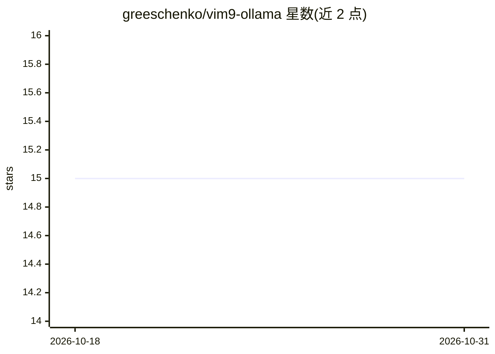

# greeschenko/vim9-ollama

⭐ 15 · Vim Script · MIT · 推送 2026-03-14 · [GitHub](https://github.com/greeschenko/vim9-ollama) · 个人维护

**Vim 9 本地 AI 编程助手插件：基于 Ollama 的聊天/改写/补全**

用 Vim9script 编写的 Vim 插件，通过本地 Ollama 服务在编辑器内提供 AI 功能：OllamaAsk 问答（分屏显示回答）、OllamaChange 对选中代码重写/重构、OllamaRead 代码审查，以及实验性的行内补全（Ctrl+L 触发、Ctrl+F 接受，采用 Fill-in-the-Middle 提示）。所有推理在本地运行，代码不离开本机。要求 Vim ≥ 9.0 与 Ollama，经 vim-plug 安装，插件启动时自动拉起 Ollama 服务；模型、温度、token 限制与提示模板均可通过全局变量配置。

## 筛选速览

| 维度 | 判定 | 备注 |
|---|---|---|
| AI 角色 | `ai-ecosystem` | LLM/agent 周边工具 |
| 许可风险 | `permissive` | MIT |
| 部署形态 | `None` |  |
| 模型依赖 | local-ok | 支持本地模型 |
| 硬件要求 | — | 无带数字的原话,不猜 |
| 安装摩擦 | `low` | 无编译、无系统依赖或容器化 |
| 成熟度 | `idea` | |

## 能力要点

- OllamaAsk/OllamaChange/OllamaRead 三类命令覆盖问答、改写、审查
- 实验性行内补全使用 Fill-in-the-Middle (FIM) 提示，ghost 建议插入光标处
- 全部推理经本地 Ollama 运行，代码不出本机
- Vim9 autoload 架构，函数按需加载以保持启动速度

## 适用场景

- 在 Vim 内让本地 LLM 解释或重构当前代码
- 对选中代码做 AI 审查并查看改进建议
- 离线环境下获得类似 Copilot 的行内补全

## 场景标签

`代码生成` `代码审查` · 领域:编码与开发

## 证据(README 行号)

> L5: `vim9-ollama` is a modern **Vim9script plugin** that integrates **local LLMs** into Vim.
> L8: All AI inference runs **locally** using **Ollama**, so your code never leaves your machine.

## 星数曲线

2026-10-18 15 → 2026-10-31 15（+0）

---
*卡片 v1 · prompt 1.4 · 生成 2026-10-30 · 置信度 high · 依据 README sha `ba4a08310678` · [字段定义](../../DATASET.md)*
