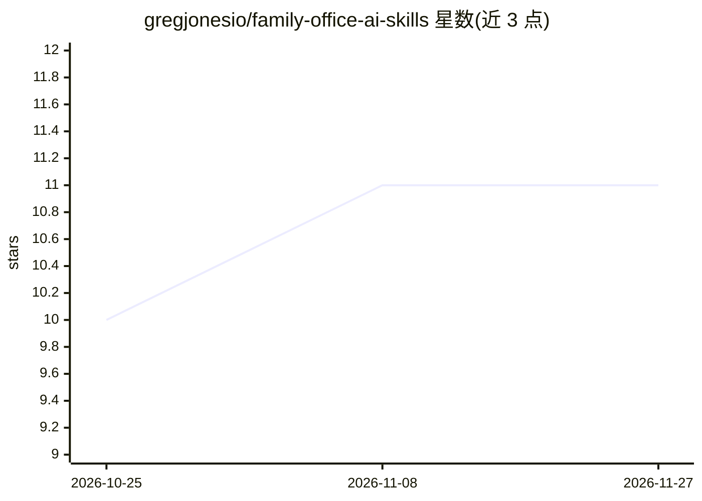

# gregjonesio/family-office-ai-skills

⭐ 11 · NOASSERTION · 推送 2026-10-21 · [GitHub](https://github.com/gregjonesio/family-office-ai-skills) · 个人维护

**面向家族办公室与财富管理团队的 AI 技能/提示词工作流库**

为精简家族办公室、RIA 及财富运营团队提供的开源库：15 个结构化 AI 工作流（SKILL.md 契约+示例+测试套件）、端到端蓝图、playbook、模板与治理文档。每个技能定义输入、输出结构、行为规则与禁止事项，输出均为供人工复核的草稿；声明不构成投资/法律/税务建议，要求只使用脱敏数据。技能为 model-agnostic，可适配进支持技能文件的 agent 运行时或系统提示词。

## 筛选速览

| 维度 | 判定 | 备注 |
|---|---|---|
| AI 角色 | `ai-knowledge` | 知识聚合/清单类 |
| 许可风险 | `permissive` | NOASSERTION |
| 部署形态 | `None` |  |
| 模型依赖 | — | README 未给出锁定关系 |
| 硬件要求 | — | 无带数字的原话,不猜 |
| 安装摩擦 | `low` | 无编译、无系统依赖或容器化 |
| 成熟度 | — | 结构信号不足 |

## 能力要点

- 15 个结构化技能（SKILL.md 契约 + 示例 + test-kit）
- 六层参考架构与 AI Workforce 运营模型等治理文档
- 技能为 model-agnostic，适配任何能遵循结构化指令的助手
- 每个技能附带虚构端到端示例（输入+输出）

## 适用场景

- 每周为主理人生成结构化简报供人工审核
- 将交易材料整理为一稿投资备忘录做初筛
- 核对资本催缴通知、续约合同与账目差异
- 为财富管理团队搭建内部 AI 工作流规范

## 场景标签

`提示工程` `金融量化` · 领域:Agent 开发

## 证据(README 行号)

> L10: An open-source library of structured **AI skills, prompts, and workflow templates** for single-family offices, mult
> L91: Engineers and operators building AI assistants, agents, and internal tooling for wealth and finance. Each `SKILL.md
> L95: These skills are **model-agnostic**. They work with any capable AI assistant that can follow a structured instructi

## 星数曲线

2026-10-25 10 → 2026-11-27 11（+1）

---
*卡片 v1 · prompt 1.4 · 生成 2026-11-18 · 置信度 high · 依据 README sha `628ab4f18063` · [字段定义](../../DATASET.md)*
