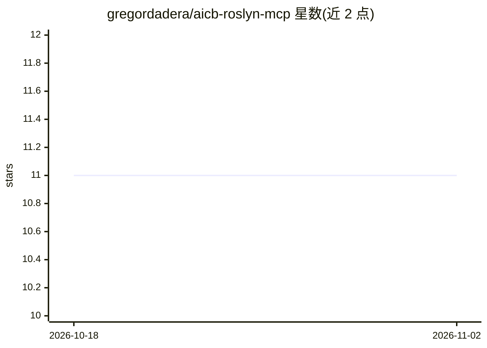

# gregordadera/aicb-roslyn-mcp

⭐ 11 · NOASSERTION · 推送 2026-10-29 · [GitHub](https://github.com/gregordadera/aicb-roslyn-mcp) · [官网](https://www.dadera.de/en/aicb.html) · 个人维护

**给编码 Agent 提供 C#/.NET 代码智能的 Roslyn MCP 服务器与 CLI**

AIContextBuilder (aicb) 是面向 C#/.NET 的代码智能工具：以 MCP 服务器与 CLI 形式在本地运行，另有 Windows 桌面应用。它用 MSBuild+Roslyn 语义模型分析解决方案，回答调用方、实现、依赖注入、测试、副作用与变更影响等问题，并按 token 预算把相关代码打包为结构化 Markdown（AI-Builder-MD）供 LLM 使用。默认暴露 54 个工具中的大部分，区分实测/作者标注/推断信息的出处，并披露过期与不完整信号。软件闭源，本仓库仅含文档、许可与发布；个人、教育及许可阈值以下组织免费。

## 筛选速览

| 维度 | 判定 | 备注 |
|---|---|---|
| AI 角色 | `ai-ecosystem` | LLM/agent 周边工具 |
| 许可风险 | `none` | NOASSERTION |
| 部署形态 | `desktop` | 安装包/桌面程序 |
| 模型依赖 | — | README 未给出锁定关系 |
| 硬件要求 | — | 无带数字的原话,不猜 |
| 安装摩擦 | `low` | 无编译、无系统依赖或容器化 |
| 成熟度 | — | 结构信号不足 |

## 能力要点

- 基于 Roslyn 符号图回答调用方/实现/DI/测试/变更影响等问题
- token 预算控制的任务级上下文打包（get_context/pack_for_task/prepare_task/measure）
- 可选 <ai> 语义标注与 provenance 区分（实测/作者/推断）
- remember/recall 持久化代码库记忆与快照对比（semantic_diff 等）

## 适用场景

- 让 Claude Code/Codex 等 Agent 用语义工具浏览大型 C# 解决方案
- 评估某符号变更的影响范围与覆盖测试
- 为代码审查生成有预算上限的聚焦上下文包

## 场景标签

 · 领域:开发者工具/代码智能

## 证据(README 行号)

> L12: then packs the relevant code into compact Markdown for an LLM. It runs locally as
> L111:         MSBuild + Roslyn semantic models

## 星数曲线

2026-10-18 11 → 2026-11-02 11（+0）

---
*卡片 v1 · prompt 1.4 · 生成 2026-11-02 · 置信度 mid · 依据 README sha `8f2e6171dbb1` · [字段定义](../../DATASET.md)*
